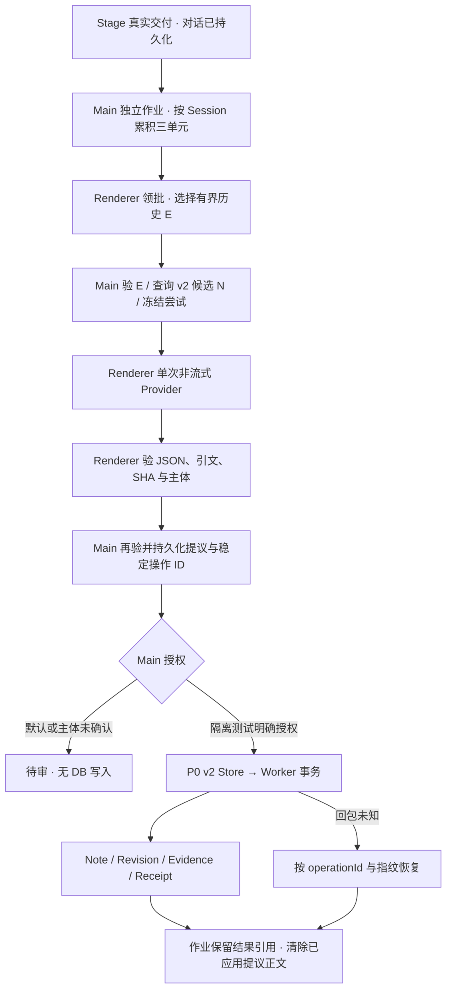

# Project Aisling · Note-only Memory P1 Formation

## 1. 基线与结论

起点为 `main`，HEAD `271d19e4a564993c22ed599076cff37cf9095720`。已有 31 个已跟踪文件未暂存修改、158 个未跟踪文件，包含 P0、现有 Main／Stage／Core Memory 变化和 Note Recall。保留现有修改、暂存区和分支。

**隔离端到端已验证。** 同一 built Stage 的真实交付回调经受控 IPC 形成批次。Renderer 调用一次非流式模拟 Provider。Main 对独立提议重验并写入 P0 Note v2，经 Worker 读回有效 Note、历史 Revision 和 Receipt。测试强制 Worker 在 SUPERSEDE 提交后丢失回包。新 Electron Main 根据稳定 operationId 和指纹确认已提交，未再次生成或创建 Note。

常规启动不接受 P1 配置，仍使用原正式 v1 和 Reflection 链路。P1 没有对实际用户 profile、真实数据库或 Provider 执行操作。

## 2. 实际改动

| 文件 | 职责 |
| --- | --- |
| `apps/stage-web/src/runtime/formation-evidence.ts`、`reflection-formation.ts` | 抽取原消息 SHA-256 和历史证据选择。旧 Formation 保留原 Prompt、适配、队列、存储和回调，继续用相同历史选择规则。 |
| `apps/stage-desktop/memory-text.mjs`、`memory-text.d.mts` | 复用敏感文本过滤、分词和 Note BM25，供旧 Raw/Organization 与新 Main 共用。对应 Web 调用位于 `runtime/memory-recall.ts` 和 `runtime/note-organization.ts`。 |
| `apps/stage-desktop/note-formation-contract.mjs`、`note-formation-contract.d.mts` | 跨 Renderer/Main 的纯协议，投影 E/S/N、校验 JSON 并映射 NoteDraft / OperationProposal。 |
| `apps/stage-web/src/runtime/note-formation.ts`、`stores/stage.ts`、`env.d.ts` | 隔离入口接真实交付、按 Provider 驱动批次、选择历史、验 SHA、取消及失败。 |
| `apps/stage-desktop/note-formation-test-host.cjs`、`desktop-app.cjs`、`preload.cjs` | 隔离 Main 宿主、独立作业文件、可信 IPC、重验与仲裁、Worker 结算。 |
| `apps/stage-desktop/memory-database/store.cjs`、`store.d.ts` | P0 v2 的已验证候选页附带累计 Evidence，供 Main 保留模型输入的删除依赖。Worker 及 Schema 沿用 P0。 |
| `apps/stage-desktop/note-formation-contract.test.cjs`、`note-formation-electron.test.cjs`、`note-formation-smoke.cjs` | 协议及隔离 Electron、Main、Worker 端到端。 |

## 3. 数据流

`useStageStore.sendStimulus` 的成功交付位置进入 fixture bridge，跳过失败、空输出、视觉、交互命令及 Note 派生 assistant 原文。Main 依据持久会话生成原始引用。每个 Session 独立累积三个交付单元，位置游标去重，超预算可短批，切换会话可 flush。历史选择复用 Raw Recall 的有界会话检索与原有「尝试／计划＋结果」条件，补充完整组，源失效时整组排除。总上限为 12 源、6,000 UTF-8 字节证据、15,000 字节请求。Main 用 P0 `listRecallHeads` 至多扫 32 页，按 BM25 选最多 5 个候选。正式 Recall 未接入此候选路径。

`createNoteFormation` 串行驱动一个尝试，调用共享 Provider 的 `complete`，温度 0.2，最大输出 1,500 token，45 秒取消。模型只看到 E/S/N 及局部会话标签，保留角色、时间和来源类别，不暴露真实 Session/Note ID、版本、digest、批次 ID 或 Origin。

## 4. 输出协议与独立适配

根对象仅有 `items`，0–3 项，每项 `{draft, action, target, reason, related?}`。draft 必含 `content, kind, basis, subject, eventTime, tags, sources`，可选 `uncertainty`。sources 为 `[{label:"E1",quote:"原文子串"}]`。subject 为程序发放的 S，target 为现有 N 或 null。ADD 无目标，UPDATE、NOOP、SUPERSEDE、RETRACT 均带目标及支撑引文，UNDECIDED 的 draft 和 target 为 null。可选 related 最多三个真实 N，只作为待审提议的一部分。拒绝额外字段，包括旧 context/keywords、Origin、模型提供的 UUID 和版本。

`parseNoteProposals` 直接返回 NoteDraft 和 OperationProposal。每个 draft 至少引用一个当前 E，历史 E 可补证或对照。按角色或字面提及验证 S，目标必须同主体。inferred、mixed 和 pattern 至少两条不同的用户原话并有 uncertainty。助手唯一来源只允许逐字归因的发言 event。事件日期只能来自引文中的有效 ISO 日期，旧状态与当前状态、相对时间和计划／完成的区别由 Prompt 明确要求，范围正确性仍属语义判断。Renderer 对本地当前消息独立重算 SHA-256，Main 从持久 ConversationStore 重建原始文本、引用及目标快照并再次执行同一合同。

Main 将引文留在待结算和待审项中，受信程序分配稳定 operationId、ADD／取代 UUID，并由快照绑定 expectedVersion。P0 `validNoteV2Operation` 与 Store 再检证据门槛，Worker 事务检查版本和墓碑。新路径没有 `parseReflections`、Reflection 对象、reflectionId、Origin、ReflectionStore 或 recallEligible。

## 5. 独立批次、写入和恢复

`note-formation-jobs.v1.json` 在隔离 profile 中由 Main 独占写入。文件上限 2 MB，flush 临时文件后 rename。包含每 Session 游标、batchId、当前 Evidence、units、attempts、状态、已登记的历史和候选依赖、逐项提议与稳定 ID／指纹。状态依次为 collecting、pending、running、settling、completed，失败记录标准原因。启动将遗留 running 标记 interrupted，已持久提议从 settle 恢复，不重新向模型生成。Provider 被取消或来源变动的批次保留失败原因，P1 未加入人工重跑入口。

应用提议后只保留 action、IDs、指纹、状态和受影响版本，删掉作业中的 proposal 正文和引文。无权限项保持 review。多项按独立 Worker 事务执行，测试包含同一批 UPDATE 成功、旧版本 NOOP 被拒绝的部分成功。Worker 丢包写入 outcome-unknown；重启先按 ID 查 Receipt，匹配持久指纹确认提交。无回执时，再以原 ID 重验和授权，避免重复 ADD。取消、过期尝试和无效 JSON 无有效 Note。

## 6. 隔离、权限与删除边界

- `startDesktop` 只有受信测试调用传入选项才可开启。要求非 packaged、built `aisling://stage`、仓库指定 artifacts 根目录的直接子 profile、fixture 标记和绝对 Worker 资源路径。Preload 只在测试 View 暴露六个固定方法。Main 对每个调用校验 webContents、主 frame 和 origin。
- 复用 P0 `createNoteV2Store`，保留 `note-v2.test.lbdb`、独立快照列、schema 握手和事务保护。没有另起一套 Worker。测试 profile 的旧 Organization 写入关闭，正常用户入口保持原来行为。
- P1 默认所有候选待审。隔离测试的 Main 回调才显式批准合成操作。未知主体即使回调允许也无法写入。原有 W0/W1 和高风险待审规则继续在正式 v1 上运行。
- 复用现有对话 journal 的读取屏障和净化快照。Main 重验本次 E 及实际看到的 N 累计 Evidence，拒绝删除后迟到的提议。隔离测试在 Worker 提交窗口拒绝会改坏当前输入依赖的对话变更。该窗口仅覆盖同一测试 Main。
- P1 未接入真实 ConversationStore 删除到 v2 DB 的持久擦除与已提交后代清理。删除后仍存于已完成作业的待审引文、已经提交的派生记录、重启期间的跨存储状态仍需完整 v2 journal 处理。正式 profile 继续禁用 P1。

## 7. 测试与限制

| 验证 | 最终结果 |
| --- | --- |
| Core、Stage Web | Core 110/110、Stage Web 402/402。 |
| Desktop、Main／Worker | 71/71，含四项新协议测试、隔离 P1 Electron、原 Note v1 Electron、P0/v2、擦除、桌面与 TTS 回归。 |
| 隔离 P1 Electron | 真实交付、三单元、一次调用、零产物、跨会话 inferred pattern、过去／现在及 null eventTime、未确认主体待审、Main 拒绝伪造引文、源删除后拒绝迟到输出、取消、非法 JSON、ADD／UPDATE／NOOP／SUPERSEDE、逐项失败、Worker 提交后丢包和新 Main 恢复均通过。 |
| 类型与生产构建 | Core、Stage Web、Stage Desktop 类型检查及 Vite 生产构建通过。构建保留已有主 bundle 超过 500 kB 的提示。 |

首轮 Electron fixture 使用了现有历史触发式未覆盖的「没有开始」，因没有历史 E 被测试拒绝。改为已覆盖的合成交互措辞后端到端通过，旧历史规则保持原样。早期 Desktop 类型检查因新声明引入 Core 全量源码而失败，改为协议所需的最小结构声明后通过。未用真实模型评估推断质量，未执行旧数据迁移或长时间规模测试。复跑隔离端到端先执行 pnpm build，再设置 AISLING_MEMORY_DB_P0_TEST_RESOURCES 指向含 P0 Note v2 的已准备资源，运行 node --test apps/stage-desktop/note-formation-electron.test.cjs。

## 8. 下一阶段接口

Recall 可从 P0 的 `listRecallHeads` 消费已提交且验源的 v2 heads。已提交 Revision、Receipt 和作业中的输入引用可供验收，不从待审提议读取语义记忆。P1 不选择 Note Recall 的预算或图关系策略。

切换前需要把现有 journal 的持久 intent、v2 擦除、上下文依赖和快照作废接成统一协议，完成线上授权及身份规则，再演练 v1/Reflection 向独立 v2 库的验证迁移。本次 JSON 作业属于测试宿主过渡状态，正式化后应由选定的持久作业入口接替，fixture flag、测试授权和双路径分流随过渡退役。
