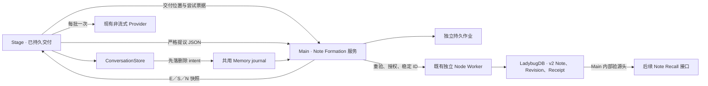
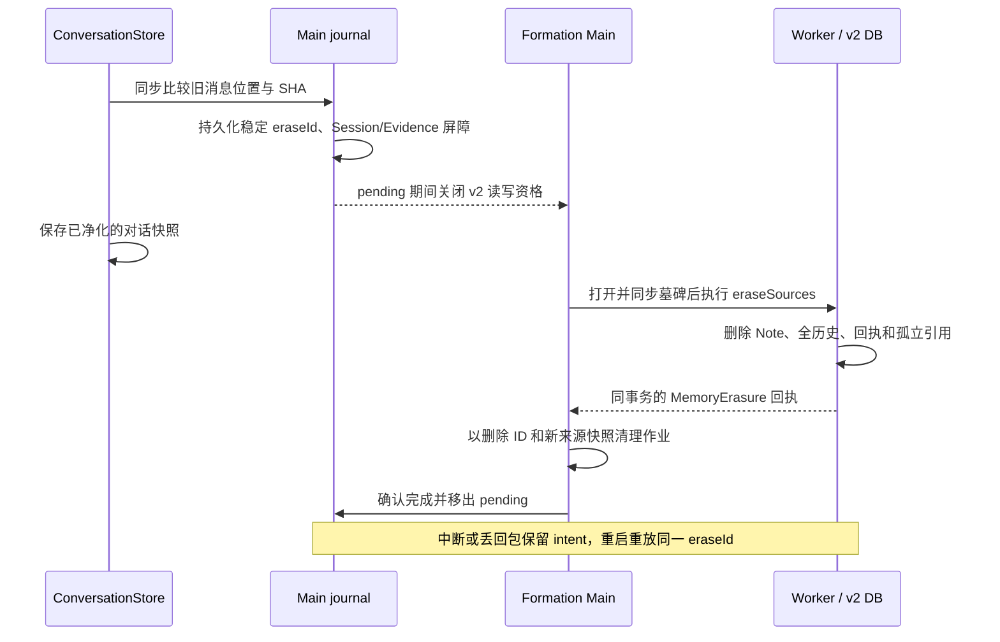

# Project Aisling · Note-only Memory P2 生命周期

## 1. Git 基线与结论

起点为 `main`，HEAD `271d19e4a564993c22ed599076cff37cf9095720`。起始工作区有 32 个已跟踪文件未暂存修改、169 个未跟踪文件，包含 P0／P1 和仍在开发的旧 Memory 路径。保留既有变更、分支和暂存状态。

标准 `startDesktop` 已能在显式隔离配置下驱动正式的 Note Formation 服务。真实交付生成 Note v2，原始来源删除由现有耐久 journal 协调对话、Worker 和作业清理。隔离测试验证实际 DB 写入、原消息和历史依赖擦除、重启及竞争。日常启动保持旧基线，v2 没有用户开关或默认启用路径。没有访问真实用户 profile、真实 Provider 或迁移旧库。

## 2. 修改文件与职责

| 文件 | 改动 |
| --- | --- |
| `apps/stage-desktop/note-formation.cjs` | 从 P1 移出的正式 Main 服务。包括工作队列、v2 profile 约束、受信授权、恢复前置、上下文依赖和逐项结算。 |
| `apps/stage-desktop/note-formation-test-host.cjs` | 缩为 fixture 路径／标记检查和可信测试选项。作业、授权调用、擦除、DB 读写均走正式服务。 |
| `apps/stage-desktop/desktop-app.cjs`、`preload.cjs`、`desktop-store.cjs` | 标准 Main 显式选择单一权威，复用可信 sender/frame/origin IPC。v2 隐藏旧 Organization 和 Reflection 桥。恢复写 ConversationStore 的临时文件刷盘。 |
| `apps/stage-desktop/memory-lifecycle.cjs`、`memory-evidence.cjs` | 复用旧 journal 文件和恢复循环，引入 v2 Evidence/Session 格式、依赖清理、启动审计及校验。统一读取会话、计算 SHA-256。 |
| `apps/stage-desktop/memory-database/{protocol,worker,adapter,note-v1,erasure,store}.cjs`、`store.d.ts` | 正式 v2 文件和握手、事务写入 `HAS_CONTEXT`、读取和删除两类来源依赖。复用同一 Worker、版本、回执和墓碑。 |
| `apps/stage-desktop/note-v2-lifecycle.test.cjs` | 原生数据库故障注入、摘要修改、共享证据、待审、派生、重启和并发删除。 |
| `apps/stage-desktop/note-formation-electron.test.cjs`、`note-formation-smoke.cjs`、`memory-note-v2.test.cjs` | 标准 Electron 的 default/write/reopen/erase 四阶段，以及 P0 测试库改名后拒绝打开正式 v2 的回归。 |

Renderer 继续使用 P1 的 `createNoteFormation` 和原有真实交付入口。Core、Recall 装配和设置页面保持当前代码路径。

## 3. 运行链路

- `note-formation.cjs` 的 `delivered/next/prepare/submit` 承接 P1 的三单元、12 源、一次模型调用、取消和重启。Renderer 与 Main 共用 E/S/N 合同，分别验源。Main 从持久对话重建引文，检查可信主体，读取当前目标以验证 active、subject 和 expectedVersion，Worker 事务再验版本。
- `note-formation-jobs.v1.json` 存批次、当前证据、实际输入引用、N 版本、逐项提议、状态、稳定 operationId 与指纹。保持 2 MB 上限、临时文件 flush 和 rename。已应用后清除引文和草案正文，仅保留状态及结果版本。失败、待审和回包未知按项记录，不把同批多事务视为整体原子。恢复按 Receipt 和指纹确认已有提交。擦除涉及该批的证据或候选时，删除受影响作业及待审内容，迟到票据失效。
- Main 的 `authorize(proposal, command)` 为内部信任边界，默认拒绝自动提交。只有 fixture 中受信测试代码提供批准策略。未知主体和超过上下文依赖预算的项保持待审，模型输出和 Renderer IPC 无批准口。原 v1 W0/W1 继续在旧模式生效，高风险动作没有新增用户权限。

## 4. 数据库入口和单一权威

| 模式 | 文件与启动规则 |
| --- | --- |
| 默认旧模式 | 常规 Main 仍进入原 v1 Organization 和 Reflection。任何已标记为 v2 的 profile 都拒绝回到默认旧模式。 |
| P0 兼容测试 | `note-v2.test.lbdb`，既有 `note-v2` 握手和 `Note.snapshot_v2`。 |
| P2 显式运行 | `<userData>/memory-note-v2/note-v2.lbdb`，`note-v2-runtime` 握手与 `Note.snapshot_v2_runtime`。 |

显式 P2 配置由可信 Main 调用传入，限定 built Stage origin，并请求 Electron 独占实例锁。profile 先写入 `memory-authority` 标记。未标记但已有旧 Memory/journal 或作业的 profile 拒绝自动切换，已标记 profile 若混入旧 Memory 文件亦拒绝。v2 不实例化旧 Organization 服务，Preload 只给该 View 提供新 Formation 桥。旧 Reflection IPC 即使被探测也无法通过 v2 生命周期的读写守卫。

`protocol.cjs`、`worker.cjs` 和 `adapter.cjs` 共同验证实际文件路径、普通单链接文件、schema 及握手。新库使用独立物理列和 runtime 操作合同，复制或重命名 v1/P0 库不能绕过验证。打开、Worker 退出、关闭及重开沿用 P0 客户端。每次新 Worker Ready 后重装耐久屏障并重做来源审计。

## 5. 耐久删除与恢复

1. `desktop-store.cjs` 的对话写入口先调用 `beforeConversationChange`。移除 Session 或改变同位置的摘要时，在同一 `memory-erasure.v1.json` 写版本 2 的 intent 和哈希屏障。v2 验证每个 pending 步骤都具有对应持久屏障。重复 Session ID 的新快照在 v2 拒绝保存。journal 不记录正文。
2. `assertReadable` 让派生读、候选和写入在 pending 或损坏时 fail-closed。原对话读取仍经过 `sanitizedData`，已阻断消息／Session 无法经旧快照恢复。启动审计发现绕过正常入口而失效的既有 DB 引用，也会补记 intent。
3. `eraseSources` 查询直接及上下文引用。累计图关系覆盖历史 Revision、NOOP、共享证据与 SUPERSEDE 回执耦合。DB 事务同时写入墓碑和 `MemoryErasure`，保留无关 Note。Worker 未启动、处理中断、提交成功但回包丢失均保留同一 intent。失败对调用方可见，下一次显式恢复、就绪操作或启动用原 eraseId 重放。
4. 来源写入可与已发送 Worker 的结算竞争。删除 intent 仍先落盘并关闭资格。若 Worker 先提交，事务已带该次所有可验证输入的依赖，后续擦除会清掉这个提交。若屏障先到，Main 的验源和 Worker 墓碑阻止重放。应用层保持 pending，直到原文件净化、DB 擦除和作业清理全部完成。此流程验证了进程崩溃，未做物理断电或人工替换整个 profile 的恢复验证。

## 6. 间接依赖

- `HAS_EVIDENCE` 与 `Revision.grounds` 仍表达实际引用的直接原始证据，P0 的 inferred/mixed/pattern 最低证据约束保持有效。
- `HAS_CONTEXT` 是独立的删除依赖。只存原始消息引用，覆盖模型实际收到的其他 E，以及实际看到的每个 N 的冻结版本和当时已验证的累计依赖。Main 以 `contextEvidence` 随操作提交，Worker 在同一事务验证墓碑并落边。候选版本留在作业，DB 的扁平化上下文引用已包含先前 N 的上下文，支持跨多步擦除。
- `listRecallHeads` 继续用直接 grounds 校验认识是否有证据，同时复核全部累计依赖是否仍存在。上下文引用不能满足最低证据要求，也不用于相关性扩展。P2 没有将模型看到的 N 认定为语义派生关系。
- 每个操作最多提交 64 个去重上下文引用。超过限制或无法重验整套依赖的提议留审或拒绝。保守做法可能删除仍有充分直接证据的 Note，因为被删除来源曾进入模型输入。后续可评估更精细的隐私传播，前提是有可验证的输入依赖，不能把同批关系当成证据。

## 7. 验证

| 项目 | 结果 |
| --- | --- |
| P2 原生专项 | 四项 P2、五项 P0/v2 通过。验证 Main 在 intent 落盘后的真实退出、资源不可用、journal 缺屏障拒绝、擦除事务中 Worker 退出、擦除提交后丢回包、提交与删除竞争，以及旧 ID 重放。 |
| 标准 Electron | 隔离四阶段通过。默认无 v2 桥与库，显式阶段真实交付并写 Note v2，新 Main 从 Receipt 恢复，真实 Stage 删除 Session 后受影响 Note 从内部可召回头消失。覆盖 P1 的取消、非法 JSON、伪造引文与迟到提议。 |
| Core／Stage Web／Desktop 回归 | Core 110/110，Stage Web 402/402，Desktop 75/75。覆盖旧 Note v1 Electron、旧 Reflection、Raw、Context、普通聊天、TTS 和桌面观察回归。 |
| 类型检查、生产构建 | 工作区类型检查通过。生产构建通过，仍有主包超过 500 kB 的 Vite 提示。 |

最初 Desktop 类型检查发现目标操作联合类型读取问题，改为直接核对冻结的目标版本后通过。测试使用当前 Worker 源码及已准备的 Node 24.12.0 / LadybugDB 0.22.1 资源，无真实 Provider 调用。复跑时先执行 pnpm build，将 AISLING_MEMORY_DB_P0_TEST_RESOURCES 指向按 scripts/prepare-memory-database.ps1 准备的 P2 Worker 资源，再运行 note-v2-lifecycle.test.cjs 与 note-formation-electron.test.cjs。原有 .local 资源未覆盖，尚未准备 P2 Worker 时握手会拒绝打开 runtime 库。

## 8. 尚未达到的生产条件与 P3 接口

- `createNoteFormationService().listRecallHeads(afterId)` 是后续 Main 内部读取入口，包含启动审计、journal、直接与上下文验源。P3 还需设置独立的用户 Recall 同意、请求快照失效和 Core 的 Raw/Note 预算。当前没有新的 Renderer Recall IPC。
- 生产启用前仍需要迁移或明确的 profile 切换、已批准的写入策略与主体处理、可解释的审核流程、覆盖大库和异常关机的验证。恢复采用整 profile 的派生读取屏障，处理期间正常对话仍可使用已净化原文。
- 未来迁移须保留旧 journal 阻断、Revision／Receipt 和有效来源，另行验证 v1 与 Reflection 数据的一致性。现有 v1 库及 Reflection 文件从未由 P2 转换。
