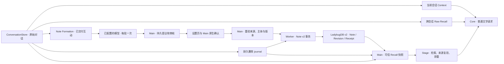
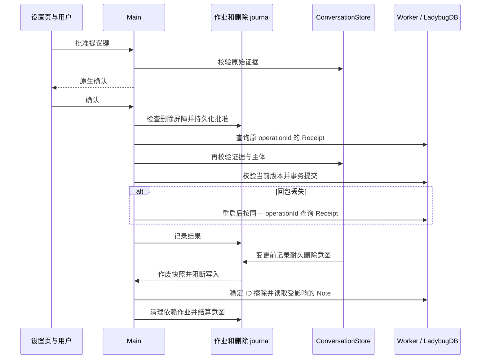

# Note-only Memory P3 工程记录

本轮完成了适用 profile 的 Note-only 运行链路、用户审核、可信 Recall 和新版 Memory 页面。**已有旧派生数据的 profile 仍运行旧链路。迁移、全量权威切换及 Reflection 模块退役尚未完成。**

## 1. Git 基线与工作区保护

- 分支 `main`，HEAD `271d19e4a564993c22ed599076cff37cf9095720`。
- 起始有 34 个已修改的受跟踪文件、172 个未跟踪文件，暂存区为空。用 `git status --porcelain=v1 -uall` 统计逐文件结果。P0–P2 实现及报告均在工作区。
- 以工作区源码为准，保留已有修改。验收时有 42 个已修改的受跟踪文件、175 个未跟踪文件，暂存区为空。未切换分支、暂存、重置、提交或推送。版本号和依赖版本未调整。
- 使用独立合成 profile、已有隔离 Worker 资源及模拟 Provider 验证。测试涉及已提交回包丢失、进程重启和擦除故障注入。未读取或修改真实用户 profile，未调用真实 Provider。

## 2. 运行结构与单一权威

`apps/stage-desktop/main.cjs` 使用 `startDesktop({noteOnlyForNewProfiles: true})`。Main 先取得 profile 独占锁，再选择权威。有构建版 `aisling://stage` 且没有旧派生状态的资料，包括只有原始对话的资料，由 Main 建立 `memory-authority`。已标记 v2 的资料重启时保持同一权威。正式文件是 `<userData>/memory-note-v2/note-v2.lbdb`，Worker 握手仍使用 `note-v2-runtime`，Schema 仍使用 `snapshot_v2_runtime`。P0 测试库、v1 和 v2 的文件与握手相互隔离。

存在旧 Reflection、旧 Note v1、P0 或旧 journal 时保留旧链路。无权威标记但出现 v2 作业或数据库目录时，启动保护阻断新旧两套写入。未知权威标记和冲突状态进入明确启动错误。v2 模式只注册 v2 Formation、审核和 Recall 入口，Reflection Storage IPC 及旧 Organization IPC 在旧模式保留。Stage 不在 v2 模式构造 Reflection Formation 或 Reflection Recall。开发服务器模式继续使用旧入口。

## 3. Note Recall 接管

1. `useStageStore` 按 Memory 和 Recall 设置调用 `prepareNoteV2Recall`。Main IPC 校验发送者、主 Frame 和 Stage origin，再调用 `recallSnapshot`。
2. Main 串行等待恢复并扫描 `NoteV2Store.listRecallHeads`。Store 筛选 Active、受信主体、有效直接 Evidence 和累计证据，包含历史 Revision、NOOP 补证和 `HAS_CONTEXT` 依赖。传给 Renderer 的快照只投影 Note 和当前 Revision 的直接依据。
3. 每页最多 4 个头。只有完整扫描才发布结果。单次最多 64 页，页间扫描预算 200 ms，Renderer 总等待上限 250 ms。并发读取共享一次在途扫描。分页不完整或 Worker 不可用时，普通文字请求使用当前 Context 和可用的 Raw。
4. 版本由 Main 生成。它绑定 Worker/写入/擦除代次和持久原始对话的摘要。新删除意图、Worker 重启、写入或对话摘要变化都能作废旧版本。每个 Provider 请求在注入 Note 前验证该版本，调用上限 150 ms。待审提议不在读取范围内。
5. Stage 复用关键词 BM25 和原有追问锚点。词项必须命中 Note 正文或标签里的具体主题。比较类提问优先考虑主题相符的 pattern，仍需有效多来源和明确不确定性。装包优先覆盖更多来源会话。Stage 复算直接证据摘要、排除仅当前会话的来源、按主题相关性筛选并限制候选规模。Note 和 Raw 对同作者的等文报告去重，Note 间按主体、依据与规范化正文去重。改写的语义等价判断仍未验证。
6. Core 先选择当前会话窗口，再分配余量。Raw 按整组装配，Note 最多三条。若未装入 Note，首轮可把预留空间交还 Raw。工具续轮复用首轮证据载荷，预算不足或版本失效时省略对应块。Note 正文使用用户角色承载，系统角色只说明如何对待这份不可信资料。正文携带 `kind`、`basis`、不确定性，并区分消息时间、事件时间和存储时间。用过 Note 的回复仍按 `noteDerived` 规则标记，禁止作为 Formation 依据。

关键代码为 `apps/stage-desktop/note-formation.cjs` 的 `recallCurrent` 和 `readRecallSnapshot`，`apps/stage-desktop/memory-database/store.cjs` 的 `listRecallHeads`，`apps/stage-web/src/runtime/note-v2-recall.ts` 的 `prepareNoteV2Recall`，`apps/stage-web/src/stores/stage.ts` 的 `getNoteContext`，以及 `packages/core/src/runtime.ts` 的 `handleUserText` 与 `runChat`。

## 4. Main 写入授权与审核

沿用 P1/P2 的持久作业、三单元批次和 E/S/N 标签合同。Renderer 只能上报已交付互动和待验证模型结果。Main 为提议分配 operationId 和内部 Note ID，记录提议指纹。生产默认全部待审，没有自动写入规则。生产 Desktop 启动入口不接收测试授权回调，Worker 与服务级故障测试的注入仍局限于 Node 夹具。

可信 Stage IPC 只提交提议键和批准/拒绝动作。批准由 Main 加载可审批记录并打开原生确认，取消默认获得焦点。原生确认后的请求回到串行服务。服务重建提议和冻结的 E/S/N，复验来源、主体、当前目标状态、expectedVersion、指纹以及设置。已批准状态在 Worker 调用前落盘，使用原 operationId 重试。结果未知时先查 Receipt 并比对指纹，确认已有结果或按同一命令恢复。拒绝终结提议。未确认主体和超出上下文依赖上限的提议可审阅、可拒绝，无法批准。

审核列表上限 20 条，同时展示待审总数。显示正文、建议动作、类型、依据、不确定性、原始引文和目标 Note 的正文。内部 ID 仅作 UI 键与 IPC 引用，不显示在页面上。

## 5. 旧资料迁移与权威切换

### 当前阻塞

旧 `note-organization.ts` 将模型输入的候选记为 `contextNoteIds`，并展开当时可见的 head grounds 到 `contextSources`。它没有固定候选版本，也没有保存等价于 P2 `HAS_CONTEXT` 的递归累计输入集合。当前 v1 Recall 检查活动头的 Origin 与直接 Evidence，不能作为完整导出入口。仅凭共享来源或正文相似性无法证明两条语义认识等价。历史 Reflection 也没有 v2 所需的受信主体。

旧 `NoteOperation` 指纹包含 Origin 和 v1 来源结构。直接复用 v1 指纹会失去 v2 幂等命令的语义。v2 的正常事务 API 为新操作生成时间并由操作生成 Revision 和 Receipt。逐条重做 ADD 无法保留原版本、修订时间、NOOP 关系和 SUPERSEDE 记录。对不可确认资料制作额外归档时，还需要可靠传播后续的来源擦除，避免归档永久保留已删除的派生内容。

因此没有执行旧资料迁移或创建迁移完成标记。当前只在无旧派生状态的 profile 初始化 v2。未标记的 v2 残留会被阻断，旧数据及旧入口继续可用。页面明确显示迁移暂停。

### 迁移恢复需要的验收

1. 在独占 profile 下展示范围并取得确认。冻结旧派生写入，结算旧 journal，核对保存后的删除屏障，再对一致的数据制作受管理的备份。
2. 对每个旧 Note 关联所有版本、原始摘要、Origin、NOOP 补证、Receipt 与取代记录。可证明的历史由专用导入事务保留原身份和时间，使用独立迁移标识和新命令指纹。记录未能证明的历史输入，保持隔离并等待处理。旧 Reflection 的归并必须验证语义和主体，不能按相同 Evidence 自动合并。旧弱关联不作为 v2 语义图边。
3. 在独立 v2 目标验证版本、Receipt、墓碑及从历史、补证、间接来源发起的删除。归档的保留和擦除规则需要一起验证。
4. 用持久迁移状态验证崩溃点和重复执行。核对完成后原子提交唯一权威。中断时要能恢复或明确阻断。未提交时维持旧权威的恢复路径。

以上是后续迁移所需的边界，当前没有可执行的旧资料导入器。

## 6. Vue 设置与工程裁切

| 文件 | P3 改动 |
| --- | --- |
| `apps/stage-desktop/main.cjs`、`desktop-app.cjs`、`desktop-store.cjs`、`preload.cjs` | 新资料选 v2、启动保护、隔离 Reflection IPC、可信审核与快照 IPC |
| `apps/stage-desktop/note-formation.cjs` | 来源验证、快照版本与分页、持久人工审批、Receipt 恢复 |
| `apps/stage-desktop/note-formation-test-host.cjs`、`note-formation-smoke.cjs`、`note-v2-lifecycle.test.cjs` | 移除 Electron 测试自动授权，改走确认 IPC，校验关闭与作废边界 |
| `apps/stage-web/src/runtime/note-v2-recall.ts`、`runtime/aisling.ts`、`stores/stage.ts`、`env.d.ts` | 正式 v2 检索、Stage 选择和桥接 |
| `packages/core/src/runtime.ts`、`index.ts` | v2 Note Context 合同、余量预算和冻结载荷 |
| `apps/stage-web/src/pages/settings/memory.vue`、`stores/settings.ts`、`config/local-storage-config-store.ts`、`i18n.ts` | Memory／Formation／Recall 三层、待审列表、真实状态与旧资料提示，中英文文案 |
| `note-v2-recall.test.ts`、`runtime-reflection.test.ts`、`stage-memory.test.ts`、`i18n.test.ts`、`local-storage-config-store.test.ts` | 验证检索、工具轮、旧基线与配置行为 |
| `README.md`、`docs/memory.md` | 更新实际使用路径，链接 P3 工程记录 |

移除了设置页的旧 Reflection、Organization 和运行调试选项。已确定 v2 权威时清理旧 Organization 设置，保留 Memory、Formation、Recall 的独立选择，旧 Organization 开关不会升级成新 Formation 授权。旧资料以单个 Formation 控件继续管理其原有设置。旧 Recall 控件在兼容模式下只控制已保存 Note 的召回。新版页面沿用现有主题变量、面板和开关组件，提议动作区可在窄布局换行。

未删除旧运行模块。旧 `reflection-formation.ts`、`reflection-store.ts`、`reflection-recall.ts`、`note-organization.ts`、`note-draft.ts`、`note-recall.ts`、v1 Origin、旧 Core 回忆接口和历史报告仍有旧资料的恢复职责。共用的 Evidence、Worker、事务和删除 journal 继续使用原实现。

## 7. 验证矩阵

| 范围 | 结论 |
| --- | --- |
| Core | 112 通过，包含工具续轮复用、失效时撤掉 Note、用户角色边界、Raw 与当前会话兼容 |
| Stage Web | 404 通过，包含 pattern、不确定性、Raw 排重、摘要失配、配置兼容、中英文及旧 Stage 行为 |
| Desktop / Worker | 75 通过，含 v1/v2 隔离、共享依据、历史版本与补证、间接依赖、事务回滚、重启、丢回包和提交／删除并发。最终产物的 Electron 与 v2 生命周期定向复验 5 项通过 |
| Electron | 合成资料的标准 Main smoke 通过，覆盖真实交付、审核 IPC、取消确认、重复批准、推断、修订、Recall 关闭与数据保留、失效、回包丢失和重启。原生对话框的按键结果由测试夹具模拟 |
| 类型检查、生产构建和 diff 检查 | 通过，构建保留 Vite 大于 500 kB 的 chunk 提示 |
| 旧资料导入、重复迁移和切换 | 未实施。已验证 v1 继续可用，以及拒绝混用权威和 Schema |
| 前端 | 验证 Memory 路由挂载、1.2 倍缩放、待审条数和证据渲染。未做逐尺寸的视觉验收 |
| 真实模型 | 未验证 Formation 的语义质量、跨经历召回覆盖率和释义级去重 |

首轮回归暴露旧请求路径被额外异步等待打断，以及旧文案断言过时。已恢复旧路径的同步启动，更新文案覆盖，最后一轮全部通过。

## 8. 剩余限制与完整验收

- P3 完整验收未达成。旧资料需要能恢复的证据导入、归档删除及唯一权威切换，完成后才能移除最后一条旧链路。
- 快照读取超过页数或时间上限时，Note Recall 安全降级。没有引入新的索引或图遍历。大型资料的 Recall 命中率和延迟仍需测量。
- Main 检查快照后，Provider 请求由 Renderer 发出。删源会阻断后续快照验证和工具续轮，已交付 Provider 的历史请求无法撤回。模型的事实判断、记忆质量及对不可信文本的遵循仍需独立实测。
