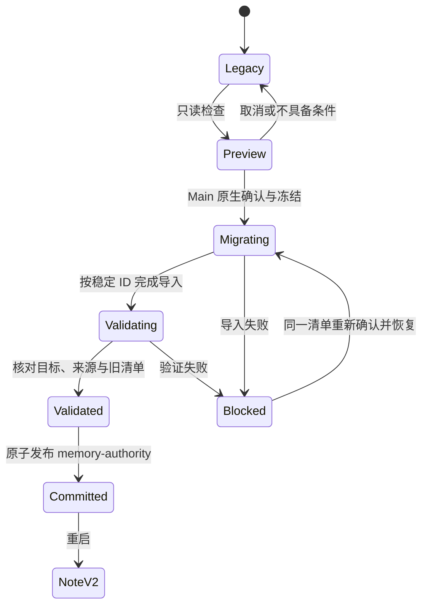
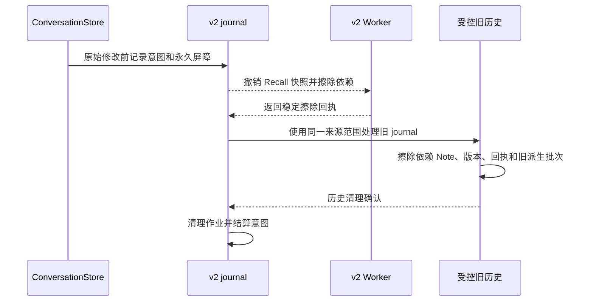

# Note-only Memory P4 迁移记录

P4 提供了从可验证旧资料到唯一 Note v2 权威的实际升级路径。遇到来源、历史输入、旧提议状态或目标库不一致时，升级保留旧资料并阻断切换。迁移只在合成资料上演练。

## 1. Git 基线

- `main`，HEAD `271d19e4a564993c22ed599076cff37cf9095720`。
- 开始时 42 个已修改的受跟踪文件、175 个未跟踪文件，暂存区为空。保留了 P0–P3 的全部工作区改动。
- 无版本号、依赖、分支、提交或推送变更。测试使用项目内的隔离 Profile 和 Worker 资源，未访问实际用户 Profile 或调用真实 Provider。

## 2. 主要修改

| 文件 | 职责 |
| --- | --- |
| `apps/stage-desktop/memory-migration.cjs` | 预检、来源与历史分类、确定性映射、独立目标导入、验证、提交与历史擦除适配 |
| `apps/stage-desktop/desktop-app.cjs`、`main.cjs`、`preload.cjs`、`desktop-store.cjs` | 正式 Main 入口、独占锁、原生确认、冻结写入、状态、重启与进程边界 |
| `apps/stage-desktop/memory-organization.cjs`、`note-formation.cjs`、`memory-lifecycle.cjs` | 排空旧写入、迁移权威判定、迁移后历史擦除和重试 |
| `apps/stage-desktop/memory-database/{adapter,client,protocol,store,worker}.cjs`、`store.d.ts` | 共享 Worker 的 v1 只读入口、历史查询和目标完整性查询 |
| `apps/stage-web/src/components/settings/MemoryMigration.vue`、`pages/settings/memory.vue`、`env.d.ts`、`i18n.ts` | 迁移入口、分类数量、原因、确认、进度、重试和双语提示 |
| `apps/stage-desktop/memory-migration.test.cjs`、`memory-migration-smoke.cjs` | 合成数据库、故障注入与 Electron 标准入口覆盖 |
| `README.md`、`docs/memory.md` | 用户入口和实际的运行模式 |

## 3. 预检与分类合同

`createMemoryMigration.preflight` 读取原始 Conversation、旧 Reflection JSON、批次与 Organization 状态、旧 journal，以及 v1 的全部可分页 Note 头。现有 v1 Worker 已打开时只调用查询。否则通过同一个 Worker 使用原生只读数据库连接，跳过 DDL 并禁止写入命令。旧 Worker 遇到首个 `--read-only` 参数会在路径验证处失败。界面只得到分类计数和有限原因码。未显示正文、原始证据、配置、文件路径或内部协议。

- **可迁移 Note**：当前头为 Active，主体在受信范围内，Revision、已关联 Receipt、Origin、历史 Evidence 和补证一致。正文、主体、basis、不确定性、标签、事件时间和当前状态保留。v1 缺少 kind，只从等文、同 basis 的有效 Origin 取得。事件时间只接受原始来源能核对的字面时间。
- **可迁移 Reflection**：独立、完整批次，直接来源及可展开的历史输入均可核对。用户归属来自原始用户消息及有明确归属的陈述。角色发言限定为原文匹配的角色事件。跨经历 pattern 要有不确定性、不同会话和至少两份独立用户报告。没有可验证事件时间的 Reflection 使用空值。
- **确定重复**：主体、严格规范化的正文、依据类型、记忆类型、不确定性、事件时间和直接来源集合相容时才合并。保留合并项的累计上下文依赖。共享一条来源、弱关联或文字相似不会触发合并。已有 Origin 对应的历史修订仍由历史记录保留。
- **仅作历史**：取代或撤回的 Note、匹配的历史 Origin 和已经明确拒绝或未决定的旧候选维持历史状态。旧 Organization 产物缺少有效资格时不会升级成可 Recall 的 Note。
- **阻断**：找不到原始消息、摘要变化、删除屏障、未完成清理、主体不明、证据不足、缺少可验证 kind、无法解释的修订或悬而未决的旧提议。仅有 v1 DB 且其 Origin 缺少可验证的原记录时阻断。非空 `contextNoteIds` 缺少当时输入版本，无法证明真正的历史依赖，仍阻断。预检分别计入无法迁移的记忆和存在问题的历史记录。总扫描有界，超限资料保持旧权威。

## 4. 导入和旧操作的处理

每个合格的当前 Note 在独立的 `memory-note-v2/note-v2.lbdb` 建立 v2 ADD 基线。v1 保留现有 Note UUID。独立 Reflection 计算新的稳定 UUID，v2 内容不保存旧实体身份。合格 Note 的旧存储形成时间仍留在旧记录，v2 基线有自己的提交时间，事件时间使用经验证的原值或空值。

`migrationId` 持久化。导入使用 `migrationId` 和新 Note ID 生成稳定 operationId，以 v2 命令计算指纹。Worker 复用 P2 ADD、Revision、Receipt 和擦除屏障。重新执行以新 v2 Receipt 判定同一命令。冲突的 Note ID、Receipt 或额外目标记录会阻断提交。

v1 的 Revision、Receipt、FormationBatch、Origin、历史操作指纹和原始创建时间保存在原历史文件。迁移没有伪造历史操作或重放旧指纹。预检核对由 Revision 引用的 Receipt 和每个版本的 NOOP 补证。无增量证据的空 NOOP Receipt 仍留原库，预检计数不枚举这类操作。取代通过共用 Receipt、两端 Revision、明确的后继 ID 和主体核对。只导入仍活动的一端，把链上的历史 Evidence 放入隐私依赖，删源仍可使当前后继失效。旧 `relatedReflectionIds` 不生成 v2 图边。

## 5. 状态机和权威切换

1. 标准 Main 在读取 Profile 权威前取得独占锁。界面在可信 Stage 主 Frame 中预检。Main 在原生对话框确认后阻断旧派生写入与原始对话修改，排空旧 Organization 操作。如果此时出现删除意图，先让旧 journal 处理，再重新核对，清单有变化则重新预检和确认。
2. 目标库创建前，以临时文件、刷新和原子重命名保存 `memory-migration.v1.json`。仅保存迁移 ID、摘要、阶段和进度，不存记忆正文、原始消息或候选命令。旧文件原位保留，升级期间冻结。已有目标只有在可验证的迁移状态下才可继续使用。
3. 恢复按同一清单和稳定操作 ID 从头幂等核对。源资料变化、锁或 Worker 错误、目标异常都保持未提交。未落盘迁移状态的失败可继续使用旧权威。已有状态的失败保持冻结并提示重试。
4. 比对目标完整头集合和可 Recall 集合，验证每条 Note 的语义字段、状态、版本、直接 Evidence 和累计依赖。关闭目标 Worker 后复查旧清单，刷新 `memory-erasure.v2.json` 和 `validated` 状态，再原子发布 `memory-authority`。只有标记和完整迁移状态同时成立才启动 v2。验证后、发布前崩溃仍需恢复，旧写入继续冻结。
5. 切换后 Main 重启。新进程只打开 v2 Formation、审核和 Recall。未切换的旧资料仍可用旧入口。当前程序的旧入口与第二实例都受权威和锁约束。忽略该协议的旧版二进制回退不在已验证范围。

## 6. 历史保留与删除

旧 Reflection JSON、旧 Note v1 DB 和旧 journal 原位作为受控历史存储。升级不制作不受管理的额外备份。升级后的 Renderer 无历史读取 IPC，Main 不实例化旧 Formation／Organization 服务。共享 v1 Worker 只在需要历史擦除时打开。

v2 journal 继承旧的来源和会话屏障，永久保留源哈希。删除或修改原始会话时，v2 擦除与旧历史清理都通过后才结算意图。旧历史侧记录自己的必要擦除操作，重复范围复用已结算的屏障和待恢复步骤。历史 Worker 不可用时保持 v2 journal 未结算，相关 Recall 和写入继续被挡住。移除旧版本、补证和取代祖先的来源时，v2 当前头与旧历史两边都受影响。重启和重复执行不能把旧资料导回新库。

本轮没有清除全部历史文件的入口。以后只有在用户确认保留范围、所有待结算擦除已完成、当前导入证据仍独立可校验，且历史存储的清除可以恢复时，才可移除相应文件和兼容擦除路径。这里的擦除是逻辑存储清理，不是磁盘块取证级销毁。

## 7. 前端

Memory 页面在旧资料上显示只读检查、可迁移和待处理数量、阻断原因，以及 Main 驱动的进度和恢复按钮。确认由原生对话框完成，默认选取消。已提交资料重启后显示已验证，普通新资料没有迁移面板。已有 v2 Formation 和 Recall 独立设置保留。升级没有把旧 Organization 同意扩大成新 Formation 权限。

## 8. 验证

| 范围 | 结果 |
| --- | --- |
| Core | 112 项通过 |
| Stage Web | 404 项通过 |
| Desktop、Worker 与 Electron | 82 项通过，其中 7 项 P4 迁移测试。包括 Electron 标准 Main 入口的旧资料、新 v2 和新建资料阶段，以及 P3 Note Formation 与 v1 回归 |
| 类型检查、生产构建、Git diff 检查 | 通过。生产构建仍提示主 chunk 大于 500 kB |
| 迁移用例 | 合成资料覆盖独立 Reflection、只有 v1 且缺 Origin、重复与共享来源、跨经历推断、无足够支持、主体和摘要失败、旧 journal、丢失历史上下文、修订、补证、撤回和取代 |
| 故障注入 | 源数据字节未改、旧资料变更后拒绝陈旧清单、事务晚期失败回滚、提交后丢回包、验证后真实进程退出、重复执行、重启、锁竞争、旧 IPC 被拦截和历史 Worker 不可用后恢复 |
| 前端 | Electron 使用构建版设置页，覆盖英文预检、原生确认取消及批准、1.2 倍缩放、中文重启状态和新资料隐藏迁移入口。原生按钮选择由夹具模拟 |

首轮测试发现活动旧清理会改变预检清单，以及 smoke 页面进入方式不稳定。故障测试改用无后台清理的只读对照，Electron 改为从构建版 Memory 路由启动。最终矩阵全部通过。Worker 使用本轮源码重备的隔离资源。本地开发使用旧 `.local` Worker 资源时需先按现有资源准备流程刷新。

## 9. 裁切与正式退役条件

| 分类 | 处理 |
| --- | --- |
| 已可立即删除 | P3 的固定「迁移暂停」用户文案已替换。历史研究报告及其可复现记录继续保留 |
| 迁移验收后可删除 | `reflection-formation.ts`、`reflection-recall.ts`、ReflectionStore 的运行时写入、`note-organization.ts`、`note-draft.ts`、旧 `note-recall.ts`、旧 Core Reflection 注入、旧 IPC 和 A/B/C 运行接口。在不再支持旧权威的版本中随测试和 smoke 入口一起移除 |
| 仅供导入或擦除 | 旧 Reflection 和批次解析、v1 Note、Revision、Receipt、Origin 读接口、v1 Schema 和删源闭包。旧正式运行链路退出后仍需要这些能力处理尚未升级的资料和受控历史 |
| 长期共用 | ConversationStore、Raw Recall、消息摘要和原始来源验证、Worker 协议、v2 事务与 Receipt、删除 journal 和永久屏障 |

符合条件的合成旧资料已经验证可切换到唯一 v2 权威。不能证明历史输入的资料保持阻断，尚无逐条人工处置或旧版二进制安全降级工具。正式退役仍要求处理这些资料，并以真实分布的脱敏样本验收来源、主体和删除语义。没有验证真实模型的语义质量或任意磁盘损坏下的恢复。
