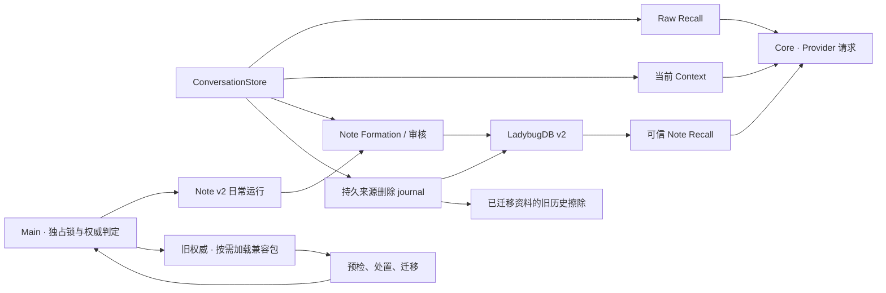

# Note-only Memory P5 退役记录

新建和已迁移的 Desktop Profile 已退出 Reflection Formation、Reflection Recall 和旧 Organization 运行时。旧资料的部分资格阻塞可以逐条选择仅保留历史。来源完整性和不可证明的依赖仍会阻断切换，因此 P5 整体为部分完成，旧 Profile 的最后一条兼容路径仍在。

## 1. Git 与验证边界

- `main`，HEAD `271d19e4a564993c22ed599076cff37cf9095720`。
- 开始时 42 个已修改的受跟踪文件、180 个未跟踪文件，暂存区为空。已有 P0–P4 工作区改动保留。
- 未切换分支、重置、暂存、提交、推送或改版本号。测试资料、Worker 和 Provider 均为合成或隔离夹具。实际用户 Profile 未访问。

## 2. 主要修改

| 路径 | 实际职责 |
| --- | --- |
| `apps/stage-desktop/memory-migration.cjs` | 预检逐条选择、旧图和来源隔离证明、版本复核、耐久处置与导入排除 |
| `apps/stage-desktop/memory-authority.cjs` | 共用 P4 权威选择、迁移状态读取与独立 Worker 路径验证 |
| `apps/stage-desktop/memory-archive.cjs`、`memory-lifecycle.cjs` | 将旧历史擦除与旧运行时拆开。v2 journal 在历史擦除确认后结算 |
| `apps/stage-desktop/{desktop-app,preload,note-formation}.cjs` | 限定模式入口，加入可信处置 IPC，收回 P0 日常环境开关和迁移成功标志 |
| `packages/core/src/runtime.ts`、`legacy-recall.ts` | 从正式请求装配移出 Reflection 提示、预算、候选 DTO 和 v1 混合排重 |
| `apps/stage-web/src/main.ts`、`stores/stage.ts`、`runtime/legacy-memory.ts` | 旧桥存在时才动态载入旧包。v2 Stage 只接 Note 和 Raw。移除运行时实验开关与重复跟踪 |
| `apps/stage-web/src/pages/settings/memory.vue`、`components/settings/{MemoryMigration,LegacyMemoryControls,ModuleToggle}.vue`、`i18n.ts` | 迁移分组、逐条处置、紧凑审核及独立旧控件 |
| `packages/core/src/config.ts`、`apps/stage-web/src/config/local-storage-config-store.ts`、`stores/settings.ts` | Core 默认和非旧 Profile 配置不再写旧 Organization 开关 |
| `apps/stage-desktop/memory-migration.test.cjs`、`memory-migration-smoke.cjs` 及 Core/Web 回归 | 补足处置、陈旧清单、历史擦除、旧包加载、UI 和设置验证 |

## 3. 迁移阻塞与可执行处置

| 分类 | 规则和处理 |
| --- | --- |
| 来源完整性 | 缺失消息、SHA 不匹配、永久屏障、journal 或目标异常必须保持阻断。只读预检可以重试，界面没有覆盖动作 |
| 记忆资格 | 主体不明或证据不足时，只有完整来源且独立的旧 Reflection 可以选择仅保留历史。kind、时间或其他合同失败仍按 P4 阻断 |
| 历史依赖 | 缺失 `contextNoteIds` 的确切输入版本、旧 Revision 或 Receipt 无法重建、记录被其他批次或旧 Note 使用时继续阻断 |
| 待结算操作 | 未结算删除、旧提议、未恢复的写入和目标冲突按原 journal／迁移状态处理。处置按钮不能关闭这些保护 |

允许处置的记录必须有唯一可辨识的展示短文、完整的直接证据与可追踪的历史输入、独立完成批次且无旧 Organization。Main 扫描旧 DB Origin 和旧批次的入向依赖，同时检查旧弱关联。存在任一依赖就不显示处置按钮。旧 Note 和无法验证的历史不在本轮处置范围。

用户可以先保留待处理状态，也可以重新预检。明确批准后，记录只保留在现有受控历史中，不生成 v2 Note。该操作不提升置信度、不替用户补证，也不直接删除原记录。没有加入逐条物理清除或全库清除按钮。实际来源删除继续使用现有完整的跨存储擦除机制。

## 4. Main 处置合同与恢复

1. 预检返回短文、原因、派生键和不透明的清单版本。正文以原有敏感文本规则筛选，截取到 160 字符。前端不接触原始会话、SHA、UUID 或 DB 查询。
2. 可信 Stage 主 Frame 只传选择键和版本，Main 重新扫描后才显示原生确认。取消不写文件。确认后重新核对同一清单和依赖，新的处置动作只在旧权威且尚未开始导入时允许。
3. `memory-migration-dispositions.v1.json` 用刷新后原子重命名保存选择键与证明哈希，没有正文和原始证据。重复请求仅在当下仍能证明同一已排除记录时返回原结果。前一个动作会作废旧清单，另一个条目必须使用新预检。只有处置元数据而找不到旧记录时，必须有旧 journal 的擦除屏障，否则继续阻断。
4. 排除决定进入迁移清单摘要。发现记录、来源或依赖变化时失效并阻断，原决定不会静默转为导入。已提交 v2 后旧处置入口消失，迁移也不能重新读取旧历史。

## 5. 当前 Memory 架构

- 新建 Profile 在构建版 Stage 上直接进入 v2。已迁移 Profile 还必须同时有 v2 权威标记、已验证状态、独立目标库和 v2 journal。Main 不载入旧迁移分类器或旧 Organization。仅已迁移 Profile 装入历史擦除适配器。
- `preload.cjs` 只公开 Note Formation、Note Recall、审核以及共用对话存储。旧 Reflection 和旧 Organization IPC 只在旧权威存在。Stage 启动按旧桥决定是否载入 `legacy-memory` chunk，新建及已迁移模式不请求该 chunk。
- 日常读取从 `noteFormation.recallSnapshot` 进入 v2 Store。原始来源、累计 Evidence、`HAS_CONTEXT`、删源屏障和快照版本仍受 P2/P3 保护。Core 的 v2 预算与原始对话上下文保持优先顺序，旧装包逻辑只通过旧兼容适配器提供。
- 迁移中或失败的 Profile 保持 P4 冻结与恢复。完成迁移前可用的旧入口继续保留。对已迁移 Profile 不重新开放旧运行时，也不会把遗留设置转成新权限。

## 6. 已裁切与继续保留

| 项 | 处理和原因 |
| --- | --- |
| Core Reflection 装配 | 移出正式 Core，请求内不再运行 Reflection 注入、双链路排重或旧预算。旧装配在 `@aisling/core/legacy-recall` 子路径，只供旧 Stage 和兼容测试。Core 中仍保留兼容诊断的静态类型 |
| A/B/C Stage 实验 | 删除实时模式字段和切换方法。离线实验测试仍可显式构造旧兼容请求。冻结的研究资料保留，其旧入口不能用现行 Stage API 重新构建 |
| 旧 Formation 运行跟踪 | 删除 Stage 复制的提议正文和运行 trace；旧实验 smoke 直接读取已经持久的旧批次。旧 v1 Recall 的必要诊断只在旧兼容模块 |
| 旧配置及 IPC | 删除非旧 Profile 的 Organization 默认值和写入行为。移除持久成功横幅及其 preload 标志。P0 环境开关不再改变常规 Main 启动，专用测试回调仍能运行原图实验 |
| `reflection-formation.ts` / `reflection-store.ts` | 未升级资料还需要其形成队列、合法读取与恢复，整体保留在旧 chunk |
| `reflection-recall.ts` / `note-recall.ts` | 未升级资料仍依赖旧有效记忆读取和来源验证，避免升级阻断后丢失 Recall |
| `note-organization.ts` / `note-draft.ts` / Main `memory-organization.cjs` | 只为旧权威保留提议、目标映射、已授权 v1 写入及旧恢复 |
| v1 Schema、Origin 与兼容历史解析 | 迁移前核对来源和旧修订，迁移后擦除历史。旧库 Worker 仅在旧兼容或必要的历史擦除中打开 |
| 共用基础设施 | ConversationStore、Raw、来源摘要、Note v2 Formation／Recall、用户审核、事务、Revision、Receipt、永久屏障及日志恢复继续使用 |

P5 删除的是已失效的正式接口、实验开关、冗余状态和内联旧装配。最后一批仍有旧资料使用者的模块完成隔离，源文件还在。

## 7. 前端

正式页保持 Memory、Formation、Recall 三个开关。Memory 说明同时涵盖原始对话回忆。数据库错误集中展示，状态未知时仍允许关闭已开启的子项。待审列表继续显示正文、依据、不确定性、引文、动作和批准／拒绝。

只有旧 Profile 显示迁移面板和旧控件。迁移库存提供四类阻断、可迁移和未解决数量，以及仅保留历史动作。确认、执行进度和恢复来自 Main。升级完成后的普通 Memory 页移除长期成功横幅。新建资料无迁移面板。

## 8. 验证

| 范围 | 结果 |
| --- | --- |
| Core | 112 项通过 |
| Stage Web | 402 项通过。退役 3 项 Stage A/B/C 开关用例，新增 v2 独立开关与旧设置隔离用例 |
| Desktop、Worker 与 Electron | 83 项通过，包括逐条处置、旧资料迁移与 v2 Note Formation 真实 Main 入口 |
| 类型检查、生产构建和 Git diff 检查 | 通过。主 chunk 约 779.10 kB，独立旧兼容 chunk 约 50.33 kB。主 chunk 仍有既有大小提示 |
| 专用 P0 Electron 烟测 | 通过，含正常 Worker、进程退出、重启和 Worker 不可用时的旧 Memory／Formation 回归 |
| 迁移与处置 | 覆盖单条、多条、有关联的记录、摘要损坏、陈旧清单、取消、重复执行、迁移后来源删除和硬阻断 |
| 旧历史 | 覆盖归档 Worker 不可用时屏障保持、回包丢失、崩溃恢复、拒绝旧写入 |
| UI 与隔离 | 通过 Electron 中英文、720×560 窗口 1.2 倍缩放与滚动、Consciousness 和 Speech 页面。DevTools 协议确认只在旧资料请求旧包，Main 模块检查确认 v2 不加载旧 Organization 和迁移分类器 |

前序验证发现 Vite 和 Vitest 的旧别名误匹配子路径，Web 旧夹具依赖运行中注入桥，以及 P0 烟测仍使用已替换的旧开关名。已修正别名、夹具初始化和界面断言，最终复验通过。

## 9. 退役结论与最后技术债

**已完成 v2 日常运行的 Reflection 退役。P5 整体仍为部分完成。** 无法证明来源、旧输入版本或 Revision／Receipt 的资料继续依赖旧兼容入口。只有这些资料得到受控处理且完成回归后，才可删除旧 Formation、Recall、Organization 和旧 IPC。历史解析和删源所需的 v1 Worker、journal 与原始源校验还须保留到受控历史本身可安全清理。

本轮未实现任意旧记录的人工改证或破坏性单条清除，也未验证忽略权威标记的旧版本二进制回退或真实 Provider。旧兼容代码仍随构建发布，仅旧 Profile 加载。
