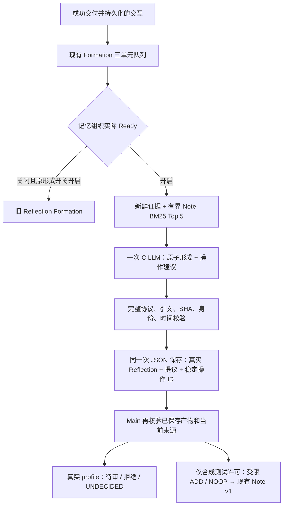

# Memory Organization P1.6：C 候选链路接入与启用阻塞

本文件保留 P1.6 的历史验收结果；当前删除恢复及受限写入政策见 [P1.7 报告](memory-organization-p1-7.md)。

2026-11-06，基于当前本地工作树；版本保持 0.3.7，未提交、未推送。

**本轮交付了实际应用中的 C 候选运行链路，未满足全部 P1.6 完成门槛。** 真实用户自动 Note 写入由 Main 强制禁止，不存在可绕过该限制的 UI 或环境开关。阻塞原因是：尚无经过验证的 Note 历史物理删除、防重放墓碑和生产新主体确认。不能把合成环境的 ADD/NOOP 测试称为真实用户自动写入已安全可用。

## 1. 审计结论与改动范围

已追踪 Formation/ReflectionStore/Reflection Recall/NoteDraft/ConversationStore、Stage 的成功交付点、设置及中英文文案，以及 Host/Store/Client/Protocol/Worker/Adapter。现有 Formation 已有三单元批次、源摘要、异步队列、45 秒取消、显式重试和独立 JSON 持久化。Note v1 已有单操作事务、不可变 Revision、Operation Receipt、失联提交查证；缺少候选枚举、来源擦除及防复活接口。

因此复用原调度；没有平行全局任务队列、第二次审批模型或主回复同步等待。新增独立 C 协议/处理器及受限 Main 服务。原始 Recall、Context 预算、历史 Reflection Recall、Persona、TTS、Live2D 和已有数据未迁移或重建。

审计未找到可证明已无消费者的正式实验模块，**本轮删除文件为零**。旧 Recall A/B/C 开发比较仍有回归消费者；P0/P1.2 smoke、故障夹具和研究报告仍为验证基础。本轮未清理任何独立研究目录。P1.3/P1.5资料仍在；指定的P1.4目录 `aisling-memory-bc-lab` 当前不存在，无法逐文件复核，比较依现存P1.5记录和正式适配说明，未伪称已重新读取缺失原始资料。新实现不从 lab 目录导入运行代码，不将实验 UUID 兼容映射搬进生产。

## 2. 实际数据流和调度



成功交付点仍是 `stage.ts` 中聊天结果已进入完整 Conversation、保存成功之后；失败生成、取消草稿及未交付内容不登记。三交互单元、最多十二条来源、已有输入限制保留。Organization Ready 时本批次只调用 C；原 Formation 开关的期望值不被改写。Organization 关闭后，旧 Formation 是否运行仍取决于它自己的开关。

关闭 Memory/Organization、Provider 变化或会话切换会取消正在生成的 C；迟到输出丢弃。中断的已请求批次记为失败，需显式重试，不后台无限再付费。已经确认且保存的结果不会因恢复再次生成。原来的队列仍是唯一调度者。应用退出由 Main 串行关闭 Worker，启动失败仅使该功能不可用。

## 3. 正式 Origin 与提议契约

O1 是本次程序控制的形成批次入口；E 是原消息，S 是主体槽位，N 是已有 Note 候选。完整必填示例及同一严格解析器位于 `note-organization.ts`。非法额外字段、未提供标签、可信 ID、版本、非法 null、越界引文及日期拒绝，不自动修补错误动作。

每个被接受的原子产物由程序生成 Reflection ID，复用正式 Reflection 字段验证和 NoteDraft 来源复核。**Reflection 与对应提议在一次 ReflectionStore 更新中真实追加并落盘后，Main 才允许处理 Note 操作。** Main 必须能在完成批次及实际 Reflection 中查到 Origin，且证据属于该产物。历史 Note/RELATED 不替代原始证据。

现有 ReflectionStore v1 增加可选 `FormationBatch.organization`，旧 JSON 不含该字段仍可读取；未改变既有 Reflection 语义字段。一个 C 批次可形成多个原子产物，本版通常每份 Draft 对应一份 Reflection；原适配器仍支持一份 Reflection 映射多个独立引文片段，不按句号或固定数量强拆。

操作、拟议语义、必要描述、弱关系建议、Origin/Evidence、稳定 operationId 和提交状态保存于本地批次。UPDATE/SUPERSEDE/RETRACT 完整解析和定位，保留原动作，不转成 ADD。UNDECIDED 不创建 Note。关系只保存为建议，未新增 v1 图写入口。

## 4. 主体、时态与提交边界

历史候选的规范 subject、ID/version 可由程序绑定到 S 标签；仍需引文中有对应提及。新主体只提供**未确认的、与源消息绑定的审阅槽位**，模型不能通过选中 S 或填写 subjectDescription 自授身份。`note-draft.ts` 的 `reviewOnly` 仅允许构造这类待审 Draft，保留 `confirmed:false`；`assertDraftTarget` 必须确认身份。它不是生产实体识别能力，也不是最终 Note subject 已确定。

事件日期/区间必须出现在选定原文并符合日历精度；未知 null，不以消息时间替代。提示词区分计划日期、完成/取消、纠错 UPDATE、真实变化 SUPERSEDE、撤回 RETRACT、同义和补证 NOOP。字段校验不能证明通用语义真实，理由不是独立证据。时态/作用域无法可靠确认的内容留待审，本轮没有用复杂关键词决策器代替语义判断。

| 动作 | 真实用户 profile | 合成许可中的额外约束 |
| --- | --- | --- |
| ADD | 一律 proposed-not-applied | 来源为 direct 用户，身份已由受信夹具确认；完整索引无已有 active Note；正文精确等于整条用户原文；时间未知；Origin/源摘要新鲜。BM25 未命中不等于可新增。 |
| NOOP | 一律 proposed-not-applied | 目标 active、版本一致，原必要来源和 Origin 仍有效；正文、主体和事件时间与目标一致；新增 Evidence/Origin 归属同一目标版本。 |
| UPDATE/SUPERSEDE/RETRACT | proposed-not-applied | 同样不自动提交，保留完整建议与目标。 |
| UNDECIDED | 无数据库操作 | 同左。 |
| 不合格提议 | 拒绝及固定原因码 | 同左。 |

`allowWrites` 仅是 Main 服务构造器的合成测试注入，正式 `startDesktop` 从不传 true；普通 Renderer 不能传此值。**不建议通过删除该守卫启用真实写入**：删除与身份阻塞必须先形成正式契约及验收。

## 5. 持久处理身份、恢复与部分结果

生成确认后，Reflection、Note ID、operationId、版本预期及原建议一并落盘。然后逐项调用 Main。JSON 与 LadybugDB 不假装跨库原子：一个合法批次内操作可分别成功或拒绝，状态分别保留；整个模型输出未通过验证时不保存产物、不提交任何操作。

恢复先使用已保存身份查 Operation Receipt；查得时比较正式规范化指纹，防止同 operationId 的内容被篡改后误认成功。没有回执才考虑后续政策和事务。回复丢失保留 outcome-unknown，下一次显式启用进行回执查证；不会为已确认产物换随机 ID 重落库。来源和开关在每项提交前重新检查；已进入事务的写入遵循既有原子提交边界，关闭不会发起后续操作。

Main 启停使用串行生命周期，修复了 Renderer 重载时关闭/开启交错可能导致 Worker 无法重新 Ready 的竞态。没有引入第二套写入语义或通用任务系统。

## 6. 有界候选查询

Note v1 新增只读 `listNoteHeads(afterId)`：按 UUID 游标每页最多 8 条权威快照及该版 Revision grounds，额外第 9 条仅判断是否有下一页。没有新增 Schema 列或改变事务。P0 不接受此 API，仍拒绝任意 Cypher。

Main 最多建立 256 条头部缓存，达到上限标记 incomplete；不把不完整索引当作不存在重复的证据。新增本服务写入会失效缓存，重启重建。单写者和文件锁限制其他写入；未来增加人工编辑接口必须同样失效缓存。每次查询仍重新核验当前 Conversation Evidence 和实际 Reflection Origin，来源或产物缺失的头不能当目标，且 complete=false。目标提交再点读版本。

Renderer 使用现有词项规则的 BM25，只将 Top 5 发送给 C。大库的查询性能尚未验收，不能声称已有完整语义索引、Embedding、主动图检索或 Note Recall。

## 7. 来源删除、日志与启用阻塞

Conversation 持久化失败时，Stage 的新鲜读取抛错，后台失败关闭。Main 直接读取当前已归一化持久消息并重算原有 JSON/SHA-256 摘要；不以长期缓存或找不到原文时的旧快照替代。

新增 C 候选/Reflection 使用已有独立本地 JSON 文件，整体 2 MB 上限；普通诊断不输出正文、原始响应或密钥。源会话删除/内容改变时，在保存 Conversation 后及下次读取 Reflection 时清除失效 C 批次、对应正文、提议及反向弱引用。由于模型曾看过整个批次，按整个输入批次保守清理；其他仍有效批次即使共享一份证据也保留。已有历史 Reflection 不因本轮开启功能被删除。应用没有另建 Memory 重置或 Reflection 删除 UI；外部移除原文/产物也会使候选资格失败。

**尚未实现：Note、Revision、Receipt、共享 Origin/Evidence 的经过验证的物理擦除和防重放墓碑。** RETRACT 不能代替擦除，简单删除当前快照或整库也不能满足共享来源和恢复要求。因此真实 Note 自动写入在 Main 层禁用，真实候选模式不会派生这些数据库正文。JSON 删除与源文件写入不是跨文件事务；若进程在两者之间退出，下次读取重新清理。备份、系统回收站、磁盘取证级擦除和自定义 profile ACL 未验收。

## 8. 前端与运行

设置 → Memory 增加“记忆组织 / Memory Organization”，默认关闭，复用 ModuleToggle 和已有布局。无 Desktop 或 Provider 时不可开启；Worker/资源缺失时实际 Ready=false，显示失败，聊天不等待它。期望开关与 Ready 分开，显示关闭、启动、运行、失败或待审。候选模式明确提示禁止自动 Note 写入，没有伪装成完整自动 Evolution。

老配置缺少 organizationEnabled 时为 false；Memory 总开关关闭同时清除形成和组织的同意，重开不自动恢复；不替换用户其他 Provider 或模块配置。原 Formation 开关保持独立，运行时 C 优先，关闭组织可恢复旧形成模式。

开发资源默认使用仓库 `.local/memory-database`，或复用绝对路径 `AISLING_MEMORY_DB_P0_RESOURCES`；打包时使用 `process.resourcesPath/memory-database`。资源须含当前 Worker 源文件和已验证 Node/Ladybug 运行时；旧 Worker 缺少候选读取能力也视为不可用。正式模式不要求开启 P0 隔离 profile 环境开关，也不改变普通 userData 路径。数据库位于该 profile 的 `memory-organization/note-v1.lbdb`。

## 9. 实测与证据

日志均在 `artifacts/`，合成数据库及联机额度记录在 `artifacts/memory-organization-p16/`。

| 检查 | 结果 / 日志 |
| --- | --- |
| Core | 110/110，`p16-core.log`；含真实 usage 返回与不估算缺失计数。 |
| Web | 395/395，`p16-web.log`；最终使用单Worker、关闭文件并行，保留30ms Recall业务预算和全部断言。含 C 协议、编号、源标签、身份、三单元单轮、取消、持久产物先于处理、重复恢复、四类目标动作及配置。 |
| Desktop/Worker/Note v1 | 46/46，`p16-desktop-full.log`；含真实 Electron Note v1、重开、回滚、丢失回复、锁冲突、P0/v1，以及 Main 隐私禁写。后续边界定点复跑见 `p16-final-boundaries.log`。 |
| 类型检查 / 构建 | 通过，`p16-typecheck.log`、`p16-build.log`；保留既有大 chunk 提示。 |
| 真实应用 C 离线 | `p16-electron-final.log`：设置开关、三单元 C=1/旧形成=0、实际持久 Origin/操作身份、禁写、关闭、已配置 Provider 重载 Ready、恢复零生成、源删除。 |
| 缺资源应用 | `p16-electron-missing.log`：Ready=false/database-unavailable，聊天可用。 |
| 旧能力真实 smoke | `p16-context-smoke.log`、`p16-formation-smoke.log`、`p16-memory-smoke.log`、`p16-legacy-smokes.log`（TTS）：均通过。 |
| 默认启动完整 smoke | `p16-prod-baseline.log`：应用挂载及前序检查完成，后续 desktop composerShown 断言失败；没有修改或移除该断言，未声称完整默认 smoke 全通过。 |

联机使用环境中已授权 DeepSeek 测试密钥，仅虚构资料。第一次上游成功但测试代理漏 CORS，未进入应用验证，消耗输入1285/输出127；保留失败日志。修复测试代理后手动第二次验收成功，输入1285/输出163，finish_reason=stop。累计 **2次、2860 tokens**，预算2次/12000 tokens，45秒，无自动重试，不再调用。成功链路 C=1、旧 Formation=0、候选1、拒绝0、真实 Note 提交0（按政策阻止），不是低风险自动保存的证明。

可复现的免费检查（仓库根目录，已准备的合成资源）：

```powershell
pnpm --filter @aisling/core test
pnpm --filter @aisling/stage-web exec vitest run --maxWorkers=1 --no-file-parallelism
$env:AISLING_MEMORY_DB_P0_TEST_RESOURCES = (Resolve-Path artifacts/memory-organization-p16/resources).Path
node --test apps/stage-desktop/desktop-*.test.cjs apps/stage-desktop/memory-database.test.cjs apps/stage-desktop/memory-organization.test.cjs apps/stage-desktop/memory-note-v1.test.cjs
pnpm typecheck
pnpm build
$env:AISLING_ORGANIZATION_LIVE = '0'
$env:AISLING_MEMORY_DB_P0_RESOURCES = $env:AISLING_MEMORY_DB_P0_TEST_RESOURCES
pnpm --filter @aisling/stage-desktop exec electron memory-organization-smoke.cjs
node --no-warnings --experimental-transform-types artifacts/memory-organization-p16/audit.mjs
```

不要重置累计联机预算继续调用。一次性[审计清单](../artifacts/memory-organization-p16/audit.json)对照本轮之前保存的本地源码摘要；应用运行不依赖这些研究或审计脚本。

成功调用/解析段约1536.8 ms，上游约1440.6 ms；这是单个合成样本，不是生产性能保证，也不是完整后台时延分布。当前批次 metrics 记录准备、调用解析、处理段以及可获得的实际 usage；缺失 usage 留空，不估算。离线 mock 的100/50计数和几毫秒时延均明确标为模拟，不混入联机用量。

真实 Electron 的设置 DOM 和交互已验；隐藏窗口 `capturePage` 返回 UnknownVizError，未取得本轮设置截图，不能声称视觉像素验收通过。首次更强重载验收发现 close/open 竞态并已修复、复跑通过。初次旧 Memory smoke 因新增第三开关的数量预期失败，仅更新 DOM 数量，Recall 断言保留后通过。过程失败没有从日志中抹除。

最终全量检查中新增计时一度消耗旧 Formation 历史扫描测试的时钟 mock，已将新批次计时限定为 C 模式并修复；并行测试负载下另有未修改的 Recall 时间预算用例失败，串行单Worker全量通过。失败日志保留为 `p16-web-concurrent.log`、`p16-web-timing.log`，没有放宽业务时间预算或删除用例。

## 10. 文件职责与收束

- `note-organization.ts` / 测试：共同协议、BM25、未确认审阅槽位、正式适配及持久提议。
- `reflection-formation.ts` / `reflection-store.ts`：现有队列的 C 策略及可选批次处理记录。
- `memory-organization.cjs` / 测试、应用 smoke：受限 Main 服务、生命周期、真实 Origin/来源、回执及政策。
- `memory-database/note-v1.cjs`、`protocol.cjs`、`store.cjs/.d.ts`：有界头读取及复用规范指纹；事务/Schema 保留。
- `stage.ts`、Settings/config、Memory 页面、i18n、preload/env、desktop-app/store：正式接入、开关、受限 IPC、候选清理。
- Core Provider：可选真实 non-streaming usage；缺失保持未提供，主回复行为保留。
- 原有测试只因新增配置/开关及新的 Main 生命周期接口调整，不删除验证基础。没有独立实验入口进入主回复路径。

## 11. 尚未通过的正式门槛

1. 真实用户自动 ADD/NOOP 未启用；真实 Note 历史擦除、防复活及共享来源政策未通过。
2. 新主体没有自动身份确认；原子性、完成状态和操作语义仍需审阅。
3. 没有人工确认提交 UI、Note Recall 注入、Activation、Embedding、主动图遍历或额外 LLM 审批。
4. 大库性能、安装包、自定义 profile 权限、系统断电和完整默认 desktop composer smoke 未通过或未验。

已实测的候选接入与原有能力可保留；**不能宣布 P1.6 全部完成或真实用户自动写入安全可用**。下一步应先定义并验证擦除/防复活、主体确认，再讨论开放低风险自动提交。

参考边界：借鉴 [A-Mem](https://arxiv.org/abs/2502.12110) 的候选与联系、[Mem0](https://github.com/mem0ai/mem0) 的操作组织思路、[Graphiti](https://github.com/getzep/graphiti) 的来源与时间分离；这些是设计参考，不构成本实现正确性证明，也没有引入其完整框架。
