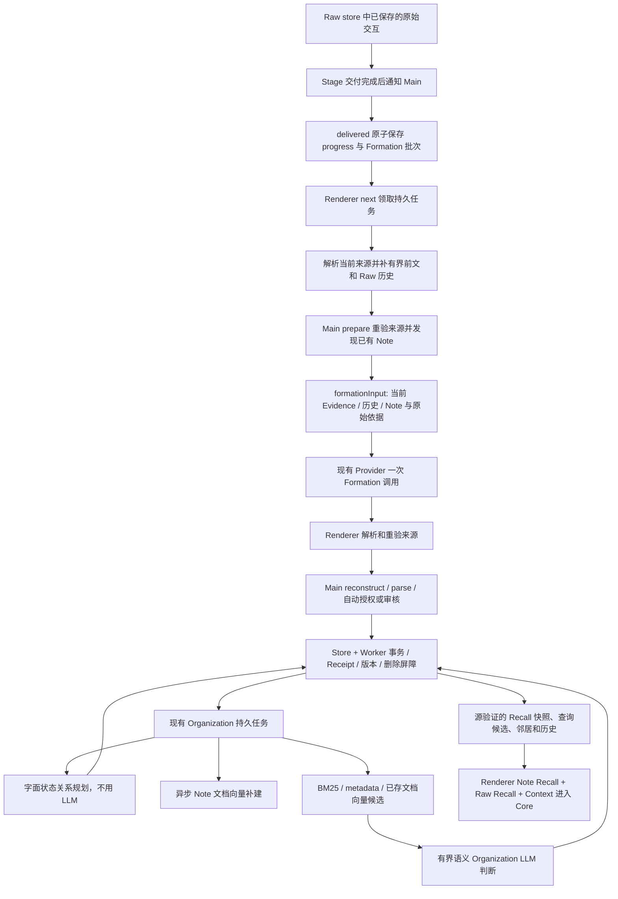

# Memory v0.4.0 P3：语义质量、上下文与演化核验

> 公开脱敏候选：真实认识、记录标识、机器路径及私有校验值仅在私人归档保留。占位标识只用于本文说明，不可运行或跨页关联；本页仍记录原阶段的测试与限制，不代表本次重新验收。

2026-11-17，Asia/Shanghai。本轮完成有证据支持的最小输入/Prompt 改进、固定基线、真实模型小样本和回归检查；**没有证明整体语义成功率提升，也没有解决所有演化缺口**。没有通过放宽合同或授权消除失败。

## A. 实际基线与数据保护

- 分支 `feat/obsidian-memory-mirror`，起点 `b6960bc07226e057211fadeaa97febd80478fd3a`，开工无暂存、修改或未追踪代码。版本仍为 v0.3.9。
- 重查 `package.json`、`scripts/dev-desktop.mjs`、Main/Profile 选择器。三个正常命令仍通过同一 Main 选择 Electron 原 userData 加 `-note-v2`；Vite/HMR 与构建 Renderer 保持区别，本轮未修改 P2 选择逻辑。
- 正式目录 `%APPDATA%\@aisling\stage-desktop-note-v2`，实际 6,631 文件、39 Session、356 消息；Formation=false、Note Recall=true、Mirror=true。作业仍为 14 completed、7 failed；Organization 语义状态为 12 completed、4 未调度、3 failed。
- Embedding 配置可解析，模型为 `qwen3.7-text-embedding`；主 Provider 为现有 `qwen3.8-flash`。配置存在不表示正在执行：Formation 关闭时，普通 Formation、后台 Organization 与文档向量补建都不运行；Recall 可独立使用查询向量。
- 用 CIM 确认无用户应用/Worker 后建立文件 SHA 清单。结束时再次核对全部 6,631 文件：新增=0、缺失=0、内容变化=0，并与 P2 冻结集合逐文件相符。因此包括主库/WAL 在内的数据仍与已验证的 19 Note、19 Revision、36 NoteOperation、17 NOTE_LINK、14 Embedding、26 Evidence、19 HAS_EVIDENCE、268 HAS_CONTEXT、5 MemoryErasure、5 MemoryTombstone 一致。这里是**本轮重新核对实际文件哈希后确认同一数据库状态**，没有在真实主库打开写连接或伪称重新查询真实库。
- `.tmp/p3-semantic/protected-files.json`、`protected-final.json` 保存保护证据；P0/P2/历史回填备份保留且未写入。所有数据库实验都在 `artifacts/` 下的隔离 Profile，没有重放真实失败批次、批量修改 19 条 Note、改开关、改 Vault 或处理 Reflection。

## B. 实际数据流与调用位置

1. **Raw → 候选认识**：`stage.ts` 在真实交付完成且会话已保存后调用 `delivered`；Main 对原始 user/assistant 消息作 digest，累计三次交付单元或 flush 成批。progress 表示持久接收，不能当作语义成功。P1 的失败历史、自动重试额度、手动恢复、operationId/Receipt 均保留。
2. **生成前历史**：旧 `withRelatedHistory` 只在当前报告同时匹配“尝试/计划”等词和“结果”等词，并且检索到的旧报告也满足此条件时补跨 Session Raw；不取同 Session 前文。新 Note 路径使用 `withNoteHistory`，详见 G。历史不注册为新交付，不回扫 Formation 游标。
3. **Main prepare**：从真实 heads 索引取得候选池；索引每次最多 200ms/64 页、总上限 2048 heads。每次仍重验累计来源，完整性是索引覆盖状态，**不是语义候选召回率**。`discoverCandidates` 是 BM25 + metadata + 可选 vector 的 RRF；Formation 的调用没有传 vector，实际只有前两者。最多选五条 Note，补上其原始 grounds，再按输入预算去掉低优先候选/整组可选历史。
4. **模型实际输入**：`formationInput` 将当前/历史消息投影为 E、会话 C、主体 S、已有 Note N；包含角色、位置、报告时间、原文、Note 字段及对应 E 标签。不发送内部 Note ID/version/digest 作为模型可操作字段。N 不是独立事实来源。
5. **LLM 判断范围**：Formation 提议 content/kind/basis/subject/eventTime/state/uncertainty、动作及可选 semantic；它不授予写权限。`parseNoteBatch` 最多三项，可独立拒绝坏项；仍拒绝空 scope、无效 target/引文、历史-only 产物、缺 uncertainty 的 pattern、多余 items 等，不截断、不补造。
6. **提交和演化**：Renderer 先解析并再次验来源；Main 用已保存 prepared refs、候选 ID/version 重建当次上下文，再解析、确定性去重并调用原 `authorizeOrganization`。授权不完整则保留审核/拒绝。ADD/NOOP/UPDATE/SUPERSEDE/RETRACT 继续走原 Store/Worker 事务、版本与 Receipt；旧 Note 的修订有严格同维度/原文条件。未引用的输入也记录为 Context 依赖，删源不能留下派生认识。
7. **Organization**：已入库 Note/version 注册到既有作业。1.5 秒唤醒执行确定性关系规划；补建向量在队列之外等待网络。后续 `nextSemantic` 用 focus 的**已有文档向量**和 BM25/metadata 检索其他 Note，最多四个候选，附两端原始依据，才发 Organization LLM。最多两条关系、每小时八次、间隔一分钟、有限尝试；不是每个 Formation 批次必有第二次模型调用。成功命令仍经版本/原文/删除与 Receipt 校验。
8. **Recall**：`note-v2-recall.ts` 从 Main 的源验证快照取 active heads，查询走本地 BM25/metadata 和可选 Main query Embedding，Main 超时 700ms，Renderer 等候上限 850ms；RRF 后再检查资格、原始来源和快照代次，按现有限额读取邻居/两跳路径/Revision。最终以带来源、时间和不确定性的投影供 Core 使用，不能将导航边当因果证据。Raw Recall 和 Context 的算法未改。

| 环节 | BM25 | Embedding | 是否进 LLM | 本轮实际执行 |
| --- | --- | --- | --- | --- |
| Formation 补 Raw | 复用 `retrieveRecall` 的 session 排序 | 无 | 通过预算的原文进入 | 19 固定案例；真实 A/B 仅合成输入 |
| Formation 选 Note | `discoverCandidates` | **未接 query vector** | 最多五条及依据 | 离线固定 heads + 原生 Main 验证；真实四对样本无已有 Note |
| 确定性 Organization | 不靠相似度直接建边 | 无 | 无 | 原生回归及新增夹具 |
| 语义 Organization | BM25 + metadata | 仅有可用的存量 Note 文档向量时融合 | focus + 最多四候选和原文 | 两个真实合成判断直接测合同/规划；其余既有全链路回归使用 mock Provider |
| Note Recall | 本地/主进程 RRF | 可选 query vector，原配置可用 | 结果进入正常 Chat 上下文 | 原有离线/Core/Renderer/Electron 回归；未对真实 Profile 发查询向量请求 |

源真实性、候选发现、模型语义、合同合法、自动授权和事务成功是六个不同层次；任何一层通过都不证明其他层通过。

## C. 研究对照

[A-MEM 论文 §3.1–3.3](https://arxiv.org/html/2502.12110) 将原子化 Note 的上下文描述、向量候选后的 LLM Link 判断、已有记忆的上下文/关键词/标签演化分开设计。Aisling 已有原子 Note、派生向量、候选、模型提议和关系；本轮证明生成前上下文存在实际缺口。论文的更新方式不能直接代替本项目的原始依据、Revision、隐私删除与授权边界，也不能把论文性能当作本项目的结果。

核对两份官方代码：[agiresearch/A-mem](https://github.com/agiresearch/A-mem/blob/main/agentic_memory/memory_system.py)、[WujiangXu/A-mem-sys](https://github.com/WujiangXu/A-mem-sys/blob/main/agentic_memory/memory_system.py)，访问日期 2026-11-17。`find_related_memories` 实际调用 Chroma 检索，`process_memory` 再用 LLM 决定演化；仅看到 BM25 的 import 不能证明某条调用链实际融合 BM25。Aisling 对“模型解释→版本化认识”的限制有工程与安全依据。本轮不引入 Chroma、另一套 Note 元数据或新的常驻记忆服务；跨 Session 无词面锚点的更强检索和共享依据的时间解释仍是待研究项。

## D. 修改前冻结的固定集

固定输入与预期在 `apps/stage-web/src/runtime/semantic-quality-cases.json`，19 个纯合成案例。SHA-256：`<PRIVATE_SHA256>`。每案保存 current、可选 previous/history/notes、预期动作范围、认识、禁止事实/关系、理由。预期在产品修改前确定，未按输出重新定义。

2026-11-17 16:56 的旧版基线先运行并保存于 `.tmp/p3-semantic/baseline.json`。旧 Prompt 原文件另存 `baseline-contract.mjs` 及其依赖。修改后对同一组来源、Note 快照、阈值、输入上限和标准再测，保存 `after.json`。

| 案例 | 固定检查重点 | 需要的上文/候选，旧→新 |
| --- | --- | --- |
| direct | 简单事实，不造品种等属性 | 无额外锚点 |
| preference-change | 保留历史偏好，不抹掉旧经历 | 锚点 ×→✓ |
| plan | 尚未报名，不改成已完成 | 无额外锚点 |
| completed | 指代的计划已完成，不宣称已学会 | 锚点 ×→✓ |
| failed-adjustment | 纸箱猫窝失败后换木箱，不编新方案成效 | 锚点 ×→✓ |
| cross-session | 已有 A Note 和新的 B 报告 | Raw 锚点 ×→✓，候选 ✓→✓ |
| resolved-pronoun | 同 Session 明确对象参与 Note 检索 | 锚点 ×→✓，候选 ✓→✓ |
| unresolved-pronoun | 无对象，空结果/UNDECIDED | 不额外引入历史 |
| duplicate | 同一稳定认识无需再次 ADD | 候选 ✓→✓ |
| different-events | 图书馆/工作室购买不能合并 | 候选 ✓→✓，禁止错误合并 |
| correction | 明确更正，但授权仍需同维度等条件 | 候选 ✓→✓，不保证自动 UPDATE |
| reported-belief | 用户未验证观点不变成外部事实 | 无额外锚点 |
| assistant-promise | 只能完整归因助手发言，不能当已履行 | 保持角色 |
| hypothetical | 玩笑/反事实应不形成现实认识 | 拒绝形成 |
| real-association | 叶形分类用于猫窝设计的具体联系 | 候选 ✓→✓，允许有依据的关联 |
| false-association | 角色名字与练琴共词，不应建边 | 候选 ✓→✓，禁止关系 |
| raw-only | A 仅在 Raw，不虚构旧 N | 锚点 ×→✓ |
| lexical-miss | 跨 Session 纯代词，词面不相交 | 仍无历史/候选，不假称 hybrid 已解决 |
| bounded-query-anchor | 同样的英文代词，但本 Session 有 Cedar 前文 | 锚点 ×→✓，候选 ×→✓ |

该固定集的自动计分是**证据可见性和候选命中**，不把预写期望当模型产出。来源理解、独立语义、事实支持、关系判断与自动授权不能从这张表推算准确率。

## E. 发现、改动与预算

| 已证实问题 | 最小改动 | 保留边界 |
| --- | --- | --- |
| 最近同 Session 前文缺失 | Note-only 补批次之前最多四条连续消息 | 不读未来；不跳过窗口内纠正/工具/不安全消息后拼接；整窗口不安全或放不下则不补 |
| Raw 跨会话门槛过窄 | Note-only 去掉经验词双门槛，复用现有 Raw 检索 | 保持 BM25 阈值、250k 字符/30ms 扫描、整组预算；含不安全材料的 Note 历史 session 整组弃用；旧 Reflection 默认路径保持 |
| Main 禁止一切同 Session history | 只接受紧邻批次开始的连续前缀、最多四条，全部重新验 digest/角色/隐私 | 不能传当前/未来、任意远处片段、重复位置或假来源；不改变 current/history 权限 |
| Note 查询只用当前片段 | 用实际供给的用户报告上文一起查 BM25/metadata | 不以助手猜测作为用户主题，不接新网络服务，不增加查询向量调用 |
| Prompt 鼓励源字面片段、条件说明混杂 | 明确独立对象、双重引用、未知即拒绝、零 items、候选非 NOOP 清单、有效 semantic 示例、pattern uncertainty 等 | 不改 parser、Note Schema、动作枚举、自动授权或重试规则；不静默修复错误输出 |

输入总上限仍为 12 来源、Evidence 6000 bytes、messages 15000 bytes；最多三项，Provider 1500 输出 token，Formation 超时 45s。可选前文/历史不挤掉当前批次；Main 溢出时仍按候选及整组历史退让。没有给每批全部历史。检索候选本身不会创建事实或关系。

产品代码仅四处：`runtime/formation-evidence.ts`、`runtime/note-formation.ts`、`note-formation.cjs`、`note-formation-contract.mjs`。其余新增为固定集、离线/真实 Provider 测试与原生安全测试及本报告。未修改 `authorizeOrganization`、`semanticRelationPlan`、Recall 算法、数据库/Worker、P2 Profile、Mirror 架构或配置。

## F. 离线对照与原生结果

| 指标 | P2 基线 | P3 | 解释 |
| --- | --- | --- | --- |
| 必需历史锚点可见 | 0/7 | 7/7 | 原始消息实际进入待提交上下文 |
| 固定 heads 中目标候选命中 | 7/8 | 8/8 | 不是模型关系准确率，也不是全库召回率 |
| 19 案平均 messages bytes | 5343 | 6696 | 增加约 25.3%，仍在同一上限 |
| 跨 Session 无词面锚点 | 未解决 | 未解决 | 没有查询 Embedding 就不能承诺语义召回 |
| 19 案的真实语义准确率 | 未测 | 未测 | 不用 mock 或规则输出冒充真实模型理解 |

新增原生用例用真实 Main 服务/Worker，但只处理合成数据：Cedar 的旧 Note 经前文进入候选；P1 中断→手动恢复→原 operation 结算；新的自包含 Note 与旧 Note 并存，旧版本不改。删除锚点后两端派生认识全部被删源闭包移除。

这里发现额外限制：新 Note 为解析代词同时引用旧锚点和新报告时，A/B grounds 会重叠。无事件日期时，既有关系规则不能证明报告范围的严格先后，**拒绝 STATE_CHANGE**；两端都有原文中的明确日期时，可以按日期建立 A→B，类型/方向/版本均经原生验证。没有把消息保存时间冒充事件时间，也没有为了建边改变该限制。这是认识依据与时间顺序表达的问题，不是候选没找到，也不能一概归因于 LLM。

## G. 一次受控真实 Provider 实验

复用当前配置与同一 `buildChatProvider`，模型 `qwen3.8-flash`、temperature=0.2、enableThinking=false、maxOutputTokens=1500；只发送固定合成文本，不发送私有历史。8 次 Formation（四案各旧/新一次），2 次现有 Organization（正/反例各一次），共 **10 次请求**，额度到达后没有重试、追加调用或继续调参。API Key 不修改、不打印；拦截器只允许现有 origin、禁止重定向并在发出前计数。没有启用 Provider 结构化输出或假定当前接口支持条件 Schema。

原始响应、逐请求用量/耗时和错误只在忽略目录 `.tmp/p3-semantic/live-results.json`；不提交模型原始响应。以下按修改前确定的案例预期人工核对，未使用第二个 LLM 评分。

| Formation 案例 | 旧版观察 | 新版观察 | 合同旧→新 / 自动授权 |
| --- | --- | --- | --- |
| failed-adjustment | 仅复述“这个方案失败”，没有猫窝/纸箱锚点，独立表达不足 | 正文明确纸箱猫窝失败后换木箱；但未引用历史锚点，且 state-change 的 target=null，无 N 时仍错误要求关系 | ✓→×（semantic-target）；两者均未获自动授权 |
| unresolved-pronoun | 提议保存无对象片段，tags 为空还违反合同 | UNDECIDED，明确指代不确定 | ×→✓；没有写入动作 |
| raw-only | 只写 B；state.scope 不是原文连续字串 | 已见 Raw A，但仍只写 B，scope 非原文连续字串，并尝试向不存在的 N 建 state-change | ×→×（首先 draft-state）；无自动写入 |
| hypothetical | 提议把完整玩笑保存为 fact，程序未授权 | 返回空 items，符合拒绝形成预期 | ✓→✓；无自动写入 |

分层结果：

- **来源理解**：无对象与玩笑两案的拒绝行为改善；Raw-only 仍未形成预期的完整连续认识；猫窝案理解了对象，却缺少要求的原始锚点引文。不能报告总体来源理解正确率或将看到锚点等同正确引用。
- **独立表达**：只看两个正例的提议正文，旧版 1/2、新版 2/2 可独立读懂；这两份新正文均未通过合同，因此不是“可用新 Note 成功率”。
- **事实支持**：这四对正文未发现新增无依据的外部事实，但新版猫窝案缺历史引文，不能声称事实支持率 100%。测试没有替模型补引文。
- **合同成功**：Formation 2/4→2/4，没有总体改善。正例完整通过并自动落库为 0/2→0/2；两个新版拒绝场景均有效，但不能抵消正例失败后声称全部优化成功。
- **自动授权**：本次 Formation 提议获授权数为 0→0；实验仅调用纯解析/授权函数，不创建 Note 或修改任何数据库。其余操作边界由既有原生授权回归及新增 Main 夹具验证。
- **Organization**：两个结果都能解析。真实联系正例错误选择 STATE_CHANGE，关系规划拒绝（应考虑 ASSOCIATED_WITH）；词面相似反例返回空关系，符合预期。按两案预设关系行为为 1/2，正例有效关系 0/1，接受的虚假关系 0/1。这里是模型关系判断失败，不是候选缺失；没有改写结果来通过检查。
- **错误合并/覆盖**：本次真实输出无 UPDATE/SUPERSEDE/RETRACT、没有实际写库；原生夹具旧 Note/version 保持，来源变化后清除派生结果。这不证明未来所有语义关联都正确。

| 真实调用成本/时延 | P2 Formation 四次 | P3 Formation 四次 | Organization 两次 |
| --- | --- | --- | --- |
| 输入 tokens（Provider 实报） | 4317 | 5367 | 1018 |
| 输出 tokens（Provider 实报） | 702 | 593 | 95 |
| 平均耗时 | 3.048s | 2.135s | 1.830s |
| messages bytes 合计 | 21385 | 26705 | 4954 |

总输入 10,702 / 输出 1,390 tokens；新 Formation 输入增加约 **24.3%**，并非免费提升。账单金额无法从本地取得，未估算货币费用。单次旧→新顺序、无固定 seed、无重复样本，延时与成功率均不作显著性/性能结论。A/B 后未调整 Prompt 再循环验证；失败原样保留。

## H. 工程验证与重现

本轮实际执行：Core 112/112；Web 432 通过、1 个真实调用用例默认跳过（该用例另行显式运行通过，确实进行了上述十次调用）；Desktop/native/backfill **147/147**、零跳过；新增两个日期有/无的原生安全案例另行 2/2；最终相关 Renderer 21 通过、1 个真实调用用例跳过。全量包含 P1 可靠性、P2 默认入口/Electron/Vite/跨模式锁、Recall、Organization、Embedding、Mirror、删除/事务和回填的隔离回归。

`pnpm typecheck`、`pnpm build`、`git diff --check` 通过；最后新增测试断言后 Web 类型检查及最终构建再次通过。最终主块 806.64 kB，保留大于 500 kB 的警告（P2 为 804.59 kB）。本轮未执行真实 Profile 回放、真实 Vault 写入、真实 Embedding 网络查询、P4 语义复审或 Reflection 回填；历史 P0/P1/P2 通过结果不计为本轮重跑。

开发期间新增夹具曾缺 runtime 必填的 `contextEvidence`，已修正；TypeScript 检查发现只读 role 赋值及纯 Node 模块缺声明，分别改为替换消息对象和测试端 createRequire，未修改产品类型来掩盖问题。新增“应建边”的探索断言暴露共享依据无法定序，随后以有/无事件日期两个明确期望保留该发现，而非放宽程序规则；两者均通过。没有未处理的工程失败。

重现离线集：在相应 checkout 下运行 `pnpm --filter @aisling/stage-web exec vitest run src/runtime/semantic-quality.test.ts`；`SEMANTIC_RESULT` 可指定忽略目录结果文件。修改前使用 P2 代码、相同固定集和 `SEMANTIC_BASELINE=1`；该标记仅记录旧候选查询与基线，不宣称新版选择器是旧实现。源测试集冻结在 Git，旧产品代码可从父提交恢复。

真实测试默认不运行。若今后明确授权另一轮额度，才设置 `SEMANTIC_LIVE=1`、绝对配置文件路径 `SEMANTIC_LIVE_CONFIG`、一个**尚不存在**的忽略目录 `SEMANTIC_LIVE_RESULT`、父提交 Prompt 及依赖副本的 `SEMANTIC_BASELINE_CONTRACT`。运行 `semantic-quality-live.test.ts`。已有输出会拒绝覆盖，不能把重跑当免费单元测试。本轮额度已用完。

## I. 未解决问题、P4 边界与结论

1. **当前瓶颈**：前文缺失已减少，真实模型的条件合同遵循、锚点引用和关系类型判断仍不稳定；当前 n=4 不支持总体质量提升结论。
2. **Note 表达**：输入足够时能提出更独立的正文，负例拒绝也改善，但两个真实正例仍未形成通过合同的可用认识。不能把好看的正文当安全落库。
3. **A→B 分层**：同 Session 有锚点可以改善 Formation/Note 检索；跨 Session 无词面锚点依旧检索失败；候选已给模型仍可能关系类型错；共享直接依据还可能使既有时间规则拒绝建边。这几类必须分别研究。
4. **仅有 Raw A**：现在可受控提供 A，无需虚构 A Note；本次真实模型仍输出无效 state 和空目标关系，故不能宣布连续认识已可靠形成，也不强制拆成两张卡。
5. **有证据的改善**：7 个锚点进入输入、1 个原先遗漏的候选被找到、无锚点/玩笑拒绝改善、原生日期正例关系与删除闭包保持。整体合同成功率、跨 Session 纯语义召回、真实演化关系质量没有充分改善证据。
6. **代价与风险**：模型输入 tokens 增加约 24.3%，调用上限不变；本轮没有接受虚假边或覆盖旧认识，但更多背景/候选不保证未来关联正确。更多输入仍会按原规则记录为 Context 依赖，删源时可能保守清除更多派生 Note。仍有 2048-head/Top-K/预算截断、含不安全内容的整组历史被省略、别名或不连续时间依据等覆盖限制。`candidateSearch.complete` 不能当成候选语义充分性的保证。
7. **P4 是否可开始**：可以从当前受保护基线开展逐条来源与语义复审；**不适合依赖当前自动 Formation 批量回填并直接退役 Reflection**。40 条旧 Reflection 仍需逐条验证必要覆盖、保留删除责任后才决定退役。Context + Raw Recall + Note v2 Recall 的目标不变，不以 profile-user 比例或 Note/边数量衡量成功。

本轮为上述最小改进与证据建立独立本地提交，本报告所在提交可用 `git log -1 --format=%H -- docs/memory-v0.4.0-p3-semantic-quality.md` 定位。没有修改版本、推送、合并或创建 Release；没有提前实施 Reflection 回填或退役。
