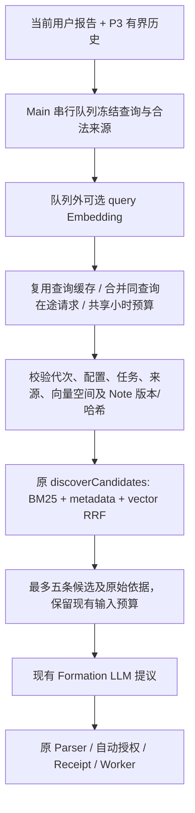

# Memory v0.4.0 P3.1：合同、候选发现与事件演化

审计/实施始于 2026-11-17，2026-11-18 继续完成。分支 `feat/obsidian-memory-mirror`，起点 `f98a1be3006af40560ffe0a9fa02d64edd2c4176`；开工工作区干净，版本仍为 v0.3.9。本轮只处理 P3.1，不处理 Reflection、P4、Profile 或 Vault。

## A. 重新审计与实际边界

重新读取 P3 报告、冻结 19 案例、修改前后结果和真实模型失败记录，并追踪当前 `prepare → formationInput → parseNoteBatch → authorizeOrganization → proposedRelations/semanticRelationPlan → Store/Worker → Recall`。P3 的真实结果仅作历史证据，本轮没有新的真实 LLM 或 Embedding 付费调用。

确认 P3 三项缺口仍存在：Formation 未传查询向量；模型把 Raw 内部变化误写成指向不存在 N 的关系；共享 grounds 的两张 Note 无日期时常不能定序。另发现确定性关系规划曾只比较最大消息位置，可能将 `[0]` 和 `[0,1]` 的重叠依据也视为可排序报告。本轮将其收紧为不相交区间。

P3 固定集未改，原始预期未改；文件 SHA-256 仍为 `ca8d9b44d8d64893a55ae91b2c73fcd30cd87d103e23533e411b5c28a3e738d5`。正式 Profile 在开始及收尾按 6,631 文件清单核对，内容不变；真实失败任务、配置、authority、数据库/WAL 和归档均未重放或修改。只做文件读取，没有连接真实数据库进行实验。

## B. 合同的三层职责

| 层 | 职责 | 不承担的职责 |
| --- | --- | --- |
| draft.content | 忠实、可独立理解的认识，可保留同一经历的尝试→失败→调整 | 不凭更完整的表达补造成功结果或日期 |
| action + target | 对已有库执行 ADD/NOOP/UPDATE/SUPERSEDE/RETRACT，或 UNDECIDED | 不以语句中出现“变化”就请求覆盖旧卡 |
| semantic | 与输入中已有 N 的比较解释；independent 表示没有既有 Note 关系 | 不代表 Raw 叙述内部没有时间变化，不允许引用不存在的 N |

Parser、字段集合、动作枚举、来源验证和自动授权规则保持。`state` 仍是可选的字面元数据，scope/value 必须同时为同一用户引文中的连续字串。不能把“纸舟项目现在暂停内测”自动修成并不存在的连续 scope“纸舟项目内测”。若 scope 不适合字面提取，省略 state，正文仍可完整表达经历。

`semantic.sources` 必须是完整用户分句的引文数组，并在 draft.sources 中；至少一个当前 E。除 independent 外，都必须有现存 N 和该 N 原始依据的 targetSources。正文合理并不能使错误操作合法：原先的 semantic-target、draft-state 拒绝是正确保护，不应静默修复。

## C. 三种合法表达

下面的完整 wire JSON 已作为 `formationExamples` 放入 Prompt，测试直接将同一对象交给 P3 冻结 Parser、新版 Parser 及原自动授权，三例均通过。因此是已有表达能力的说明修正，不是 Schema 放宽。不是模型实测结果。

1. **A 已有 Note，出现 B**：N1 为“之前开始练习钢琴”，E1 当前“我现在暂停练习钢琴。”、E2 为 N1 原文。ADD B 的 `action.target=null`；`semantic.relation=state-change`、`semantic.target=N1`、scope=练习钢琴，sources 引 E1、targetSources 引 E2。B 可有字面的 state={scope:练习钢琴,value:暂停}。A 留存，不因较新就 UPDATE/SUPERSEDE；关系要另经证据规划与事务校验。
2. **A 仅在 Raw，出现 B**：E2“之前我尝试用纸箱做猫窝，效果不好。”，E1“后来我改用木箱做猫窝。”。形成一条 event：用户报告先用纸箱做猫窝效果不好，后来改用木箱；引用 E1+E2，eventTime=null，省略 state。ADD、target=null；semantic=independent、target=null、targetSources=[]。这表示不连接既有 N，并不否认经历内部变化；不宣称木箱成功。
3. **A/B 同批已明确出现**：E1 完整说出上述先后过程。可以同样形成一条自包含 event，引用整个 E1，不强制拆成两卡；semantic=independent，不虚构旧 N。若实际为两项独立活动，仍应分开提议。

三例、无对象 UNDECIDED、零 items、非字面 state 的省略规则及引用要求均写清。未增加新的业务 Note 类型、数据库列、时序字段或宽松解析分支。Raw-only 在程序合同上可以表达；真实模型是否稳定遵循，本轮未验证。

## D. Formation 的实际混合候选链路

- 复用 `embeddingConfig/embeddingRequest`、现有持久 NOTE_EMBEDDING 和 `searchEmbeddings`，不建立服务/新库。编码文本来自经过 Main 校验的当前用户报告和已供给的有限历史；无用户报告时保留现有回退。超过安全文本限制时不发向量请求，保留词面检索。
- 从 Recall 提取共享查询实现；32 项/5 分钟缓存、同查询在途合并、现有 `queryEmbeddingCalls` 每小时 60 次预算供 Recall 和 Formation 共用，没有另加 60 次额度。Formation 消耗该池可能使 Recall 更早降级，这是资源取舍，不声称互不争用；两者的排序、资格和独立开关保持。
- 网络等待在 Main 数据库队列之外，有 700ms deadline 和 AbortSignal。空 Note 库不发请求；不可用、错误、超时或无配置时继续 BM25/metadata；关闭、删源、配置/模型/凭据变化时不接受迟到派生结果。隐私失效清缓存并取消在途；关闭同样取消。重新进入队列后检查当前任务/来源和候选版本。
- 不改变 RRF、Top-K 或输入上限：Formation 最多五候选、12 来源、Evidence 6000 bytes、messages 15000 bytes；候选不能直接授权事实或关系。已有 Organization 使用文档向量的独立逻辑保持。
- 配置没有新的 embedding.enabled 字段。沿用现有配置可解析与 Memory/Formation 同意状态；不新增 UI 开关，不修改真实配置。真实部署后启用 Formation 可能使用既有 Provider 产生查询向量费用，本轮只用 Mock。

## E. 相同输入/快照的候选对照

六个固定合成场景，两组使用完全相同文本、heads 和 Top-5；B 组只增加预设的模拟向量命中。向量刻意包含错误和低分漏召回，不能用此表证明真实 Embedding 模型质量。

| 场景 | BM25+metadata 目标命中 / 错候选数 | 加模拟向量后 | 观察 |
| --- | --- | --- | --- |
| 词面相近的蓝椅子 | 是 / 1 | 是 / 1 | 同物品的另一事件仍会进入候选 |
| 词面不同的程序停用 | 否 / 0 | 是 / 1 | 找回目标，也引入一个错候选 |
| 跨会话同一系统 | 否 / 0 | 是 / 0 | 从 vector 通道找回 |
| 不同地点的类似事件 | 是 / 1 | 是 / 1 | 错误向量分数还能将无关项挤到首位 |
| 无相关目标 | 否 / 0 | 否 / 1 | 纯误召回 |
| 向量低于阈值 | 否 / 0 | 否 / 0 | 仍有遗漏 |

五个有目标场景的 Top-5 命中 2/5→4/5，错误候选总数 2→4。有效目标改善两例，额外错候选两个；不能以“候选更多”宣称成功。每个候选保存 bm25/embedding 通道；这组无额外 metadata 命中。一次本地排序合计约 2.2ms / 11.3ms，受 JIT/调度影响，不是网络或产品性能结论。

原生 Main/Worker 测试另以 1024 维本地向量持久化真实数据库：词面无交集的正确 Note 实际进入 prepare，反向向量的无关项未进入；重试同查询及 Recall 同查询复用一次请求，持久预算计一次。超时、异常、配置变化、删源、关闭均经隔离测试。没有把固定返回值直接塞给 LLM 来冒充 Main 已接通向量。

P3 冻结 19 例重新运行仍为历史锚点 7/7、词面候选命中 8/8，原预期与上下文改进保留；这些是离线可见性/检索指标，不是语义准确率。

## F. STATE_CHANGE 的时间证据

区分三种概念：消息创建时间只证明报告时间；eventTime 仍只保存已有合同允许的明确事件日期；原文可以额外证明相对事件顺序，但不填造 eventTime。

新增的窄证据路径限于模型已经提出的 STATE_CHANGE：同主体、同 kind、direct 两端，双方都有同一个字面 state.scope、不同且不互相包含的 value；两端共享的真实用户依据中明确出现“之前/先前/起初 … A … scope”，后面出现“后来/随后/接着 … 改用/改为/换用 … B … scope”。每个分句必须仅绑定一端值，不能仅凭关键词在全文共现。

检查所有提供依据中的矛盾方向，排除假设、计划、不确定、否定、修正、撤回等材料；相对证据与明确日期方向相反时拒绝。共享依据不具备这种具体替换证明时继续拒绝。泛主题关联、A/B 都提及但无顺序、普通“后来做另一件事”、模糊/多值锚点和互相冲突叙述不因共享来源而获得边。

存储复用 `type=STATE_CHANGE, method=semantic, basis=inferred, order=event`：这里 event 表示有事件先后依据，不等于有绝对日期；uncertainty 明写仅原文相对顺序、无绝对日期、不推定当前有效。eventTime 仍为 null。现有 schema 已允许这种字段组合，无需迁移；Recall 原样携带不确定性，不生成日期。

确定性规划只收紧了重叠报告区间：以前比较两个 grounds 的最大 index，现要求区间不相交。不能证明时保持无边，由明确原文证据路径处理，而非拿 Note 创建顺序推定事件顺序。

固定七项时序对照中，明确相对替换从拒绝变为接受，其余六项无序/主题相近/假设/否定/歧义/矛盾方向仍拒绝；另测相对证据与绝对日期冲突拒绝。确定性重叠报告反例从接受变为拒绝。既有绝对日期正例保留。原生 Main→Worker 验证相对边的方向、重启后只有一条边、删源后两端及关系不能保留。

没有新增动作、主体资格、写权限或绕过授权；只为已允许的关系提供更窄的可核验证据，且收紧不可靠的报告排序。没有扩展到任意跨句指代、英文时序、无字面 state 或 CONTINUES 的共享依据推断。那些场景若需要新时序合同/字段或更大授权范围，须另作设计，本轮不强行实施。

## G. 文件范围、成本和限制

| 文件 | 改动职责 |
| --- | --- |
| note-formation-contract.mjs / .d.mts | 明确三层职责、三种真实可解析示例、可选字面 state 与 Raw-only 表达 |
| note-formation.cjs | 两段 prepare、共享查询向量缓存/在途/预算/超时、源与版本校验、降级 |
| note-semantic-contract.mjs | 窄的相对替换证据、冲突排除和明确不确定性 |
| note-organization-v2.mjs | 报告区间必须不相交，避免共享 grounds 被最大位置误排 |
| note-coordination.test.cjs | 合同示例、反例、相同快照检索与时序对照 |
| note-coordination-native.test.cjs | 真 Main/Worker、模拟向量、缓存/取消/降级、相对边事务与删源 |

本轮未更改 Parser 接受条件、Note/关系字段集合、数据库/Worker 协议、P1 恢复、P2 权威选择、Recall 总体算法或 Vault。Prompt 字节数由 P3 的 5611 增至约 6.8k；示例更明确但输入成本更高，总预算不变，可能挤掉更多低优先候选。没有真实 Token 用量/模型延时增益数据，不能把 P3 的十次调用冒充本轮实测。

仍未证明真实模型会稳定选择合法 action/semantic，也未证明真实向量能达到模拟对照的效果。Raw-only 合法表达已通过纯合同和授权验证，但不是实测可靠率。候选错误、Top-K 排名损失、缓存/小时预算耗尽和未完成文档向量都会影响覆盖。复杂相对顺序仍允许无边，不为增加关系数量降低证据要求。

## H. 验证与交付边界

本轮 Core 112、Web 432 通过；真实付费测试默认跳过。桌面全量首轮 157 项中 151 通过，六个 Electron/Vite 场景失败。定位为 Prompt 把 Mock 分流的固定前缀 `Note-only Formation.` 改成冒号，Mock 返回普通聊天文本造成 invalid-json；已恢复兼容前缀并重新构建，没有放宽解析。受影响迁移/Formation/Organization/语义文件 32/32 复验通过；剩余受影响的 Embedding/Electron 与新增协调专项 21/21 通过，包含六个失败场景的全部复验，另外空 Note 库零请求用例 1/1 通过，没有未处理失败。最终类型检查与构建通过，主块 807.72 kB，既有 >500 kB 警告保留。未把首轮全量写成一次 157/157 通过。

本轮没有运行新的付费真实 Provider 测试、真实 Profile 回放、真实 Vault 写入、Reflection 回填/退役；失败历史无意外重放。数据保护、测试日志及对照仅在忽略目录 `.tmp/p31-semantic/`，合成数据库在 `artifacts/memory-v0.4.0-p31/`；不提交私有数据或原始模型响应。

## I. 最终回答

1. 旧正文可能正确但操作非法，是把 Raw 变化和已有 N 关系混淆、把自由叙述 scope 当成字面 state、以及引用要求未落实；原拒绝规则应保留。
2. Raw-only A→B 能在现有合同表达为一条完整经历，三个合法示例经程序验证；真实模型可靠性未验证。
3. Formation 已实际接通可选 BM25+metadata+查询 Embedding 的 RRF，非仅 Prompt 预期；无配置/失败仍词面降级。
4. 模拟对照目标命中 2/5→4/5，同时错候选 2→4；不是实际模型收益。
5. 无绝对日期的明确字面替换能以带不确定性的相对事件顺序表达；复杂或不充分证据继续拒绝。
6. 主要瓶颈仍是真实模型的条件合同遵循、实体/经历一致性、复杂时间证据及真实向量候选质量。本轮不以 Mock 通过宣称总体语义质量达标。
7. 可进入 P4 的逐条人工来源/语义复审；仍不适合依赖当前自动 Formation 批量回填后直接退役 Reflection。本轮不实施 P4。

本报告随独立本地提交保存，完整 SHA 可用 `git log -1 --format=%H -- docs/memory-v0.4.0-p3.1-semantic-coordination.md` 查询。版本不变、不推送、不合并、不创建 Release。
